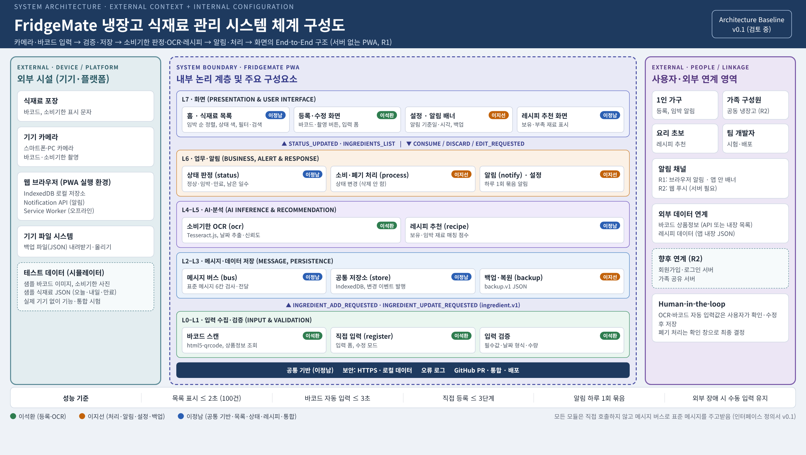

# 체계 구성도 (System Architecture)

| 항목 | 내용 |
| --- | --- |
| 버전 | v0.1 (검토 중) → 팀 확인 후 Architecture Baseline v1.0 |
| 작성 | 이정남 |
| 관련 문서 | [인터페이스 정의서](interface-definition.md), 요구사항명세서, 모듈 설계서 3종 (docs/design/) |

FridgeMate는 서버 없이 브라우저에서 동작하는 PWA다. 시스템을 **외부 시설 / 내부 논리 계층(L0~L7) / 사용자·외부 연계** 3영역으로 나누고, 내부 논리 계층의 각 구성요소를 팀원에게 할당했다. 모든 구성요소는 서로 직접 호출하지 않고 메시지 버스로 표준 메시지를 주고받는다.

## 1. 설계 절차

| 단계 | 한 일 |
| --- | --- |
| 1. 시스템 요구사항 분석 | 요구사항명세서의 기능·비기능 요구사항에서 시작 |
| 2. 분해 (Decomposition) | 시스템을 3영역과 L0~L7 계층, 계층별 구성요소로 분해 |
| 3. 할당 (Allocation) | 요구사항을 구성요소에, 구성요소를 담당자에 할당 ([요구사항 관리](../common/requirement-register.md)) |
| 4. 시각화 (Visualization) | 위 체계 구성도 작성 |

## 2. 3영역 구성

| 영역 | 구성요소 |
| --- | --- |
| 외부 시설 (기기·플랫폼) | 식재료 포장(바코드·소비기한), 기기 카메라, 웹 브라우저(IndexedDB, Notification API, Service Worker), 기기 파일 시스템, 테스트 데이터(시뮬레이터) |
| 내부 논리 계층 | L0~L7 (3장) |
| 사용자·외부 연계 | 사용자 유형(1인 가구, 가족, 요리 초보), 알림 채널, 바코드 상품정보·레시피 데이터, 향후 연계(R2), Human-in-the-loop |

## 3. 내부 논리 계층과 담당

| 계층 | 구성요소 (모듈 ID) | 담당 |
| --- | --- | --- |
| L7 화면 | 홈·식재료 목록 (list), 레시피 추천 화면 | 이정남 |
| | 등록·수정 화면 | 이석환 |
| | 설정 화면, 알림 배너 | 이지선 |
| L6 업무·알림 | 상태 판정 (status) | 이정남 |
| | 소비·폐기 처리 (process), 알림 (notify), 설정 (settings) | 이지선 |
| L4–L5 AI·분석 | 소비기한 OCR (ocr) | 이석환 |
| | 레시피 추천 (recipe) | 이정남 |
| L2–L3 메시지·저장 | 메시지 버스 (bus), 공통 저장소 (store) | 이정남 |
| | 백업·복원 (backup) | 이지선 |
| L0–L1 입력 수집·검증 | 바코드 스캔, 직접 입력 (register), 입력 검증 | 이석환 |
| 공통 기반 | 보안, 오류 로그, GitHub PR·통합·배포 | 이정남 |

## 4. 정보 흐름

식재료 1건은 아래 순서로 계층을 오간다. 메시지 이름과 형식은 [인터페이스 정의서](interface-definition.md)를 따른다.

1. **입력 (L0–L1)**: register가 바코드·OCR·직접 입력값을 검증해 INGREDIENT_ADD_REQUESTED를 보낸다.
2. **저장 (L2–L3)**: store가 저장하고 INGREDIENTS_CHANGED를 알린다.
3. **판정 (L6)**: status가 남은 일수로 정상·임박·만료를 판정해 STATUS_UPDATED, EXPIRY_ALERT_LIST를 보낸다.
4. **알림·처리 (L6)**: notify가 하루 1회 알리고, 사용자가 폐기하면 process가 상태 변경을 요청한다.
5. **활용 (L4–L5)**: recipe가 임박 재료를 많이 쓰는 레시피를 추천한다.
6. **화면 (L7)**: list와 각 화면이 결과를 표시한다.

## 5. 설계 원칙

- **표준 메시지**: from·to·type·timestamp·format·payload 6칸 형식만 사용한다.
- **저장소 단일화**: IndexedDB는 store만 다룬다. 다른 모듈은 메시지로 요청한다.
- **Human-in-the-loop**: OCR·바코드 자동 입력값은 사용자가 확인해야 저장된다.
- **장애 허용**: 카메라·OCR·외부 데이터가 실패해도 직접 입력으로 계속 쓸 수 있다.
- **R1 범위**: 서버 없음. 회원가입, 가족 공유, 웹 푸시는 R2로 넘긴다.

## 6. 성능 기준

| 항목 | 기준 |
| --- | --- |
| 목록 표시 | 100건 기준 2초 이내 |
| 바코드 자동 입력 | 3초 이내 |
| 직접 등록 | 3단계 이내 |
| 알림 | 하루 1회 묶음 |
