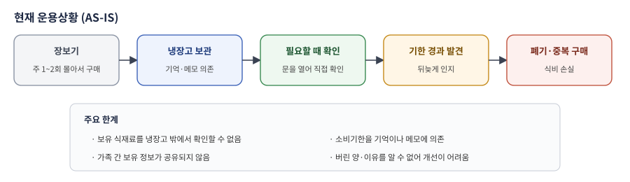
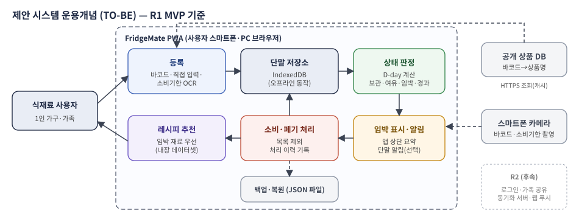
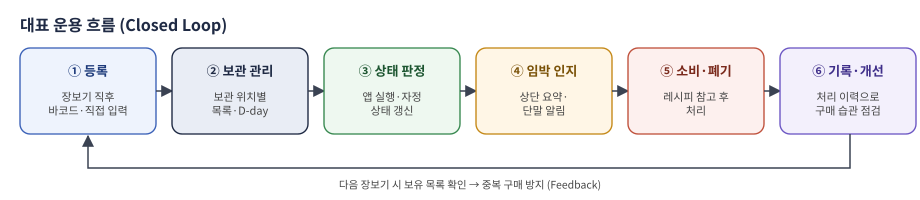

# FridgeMate 운용개념기술서 (Operational Concept Description, OCD)

> 문서번호 FM-OCD-001 · v1.0 (중간 제출본) · 2026-10-15 · 냉장고팀
> 개발 단계: ② System Requirements Analysis — 운용개념 정의

## 문서 관리

| 구분 | 내용 |
|---|---|
| 시스템 명칭 | FridgeMate: OSS 기반 냉장고 식재료·소비기한 관리 서비스 (약어 FM) |
| 문서 명칭 / 번호 | 운용개념기술서(OCD) / FM-OCD-001 |
| 버전 / 상태 | v1.0 / 중간 제출본 (Sprint 2 Review 검토 대상) |
| 개발 단계 | System Requirements Analysis — 운용개념에서 요구사항으로의 변환 기준 |
| 문서 목적 | 사용자 관점의 현재 상황(AS-IS), 변화 필요성, 제안 시스템(TO-BE), 운용 시나리오와 도입 영향을 정의 |
| 주요 사용자 | 1인 가구 사용자, 가족 공유 사용자, 냉장고 그룹 관리자, 개발팀, Product Owner·교수자 |
| 문서 범위 | 식재료 등록·보관 현황·소비기한 안내·소비·폐기 처리·레시피 추천·데이터 보호 |
| 제외 범위 | 스마트 냉장고(IoT) 연동, 장보기·결제 연동, 유료 AI 이미지 분석, 영양 성분 분석 |
| 작성 기준 | 강의자료「요구사항 분석」 OCD 개요 구조, Concept of Operations Outline, 교수자 샘플 OCD |
| 이전 문서 | `docs/conops/conops.md` (v0.1 CONOPS 초안) — 본 문서가 대체·확장함 |
| 문서 경로 | `docs/conops/operational-concept-description.md` |

[TOC]

## 1. Scope

본 운용개념기술서(OCD)는 가정에서 냉장고 식재료가 잊혀 버려지는 문제를 줄이기 위해, 식재료와 소비기한 정보를 사용자 단말에서 관리하고 기한 전에 소비하도록 돕는 FridgeMate의 운용개념을 정의한다. 문서는 사용자와 운용 관점에서 현재 상황(AS-IS), 변화의 필요성, 제안 시스템(TO-BE), 대표 운용 시나리오와 도입 영향을 기술하며, 이후 시스템·소프트웨어 요구사항 명세서(FM-SRS-001)와 Use Case 모델(FM-UCS-001)의 기준으로 사용한다.

### 1.1 Identification

| 항목 | 내용 |
|---|---|
| 시스템 명칭 | FridgeMate (프리지메이트) |
| 약어 | FM |
| 문서 명칭 | Operational Concept Description (OCD) / 운용개념기술서 |
| 문서번호 | FM-OCD-001 |
| 운용 대상 | 가정의 냉장고·냉동고·실온 보관 식재료 |
| 운용 형태 | 스마트폰·PC 웹 브라우저에서 실행하는 PWA (R1: 서버 없음) |
| 주요 이해관계자 | 1인 가구 사용자, 가족 공유 사용자, 냉장고 그룹 관리자, 개발팀(냉장고팀), Product Owner·교수자, 공개 데이터·OSS 제공자 |

### 1.2 Document & System Overview

제안 시스템은 사용자가 장을 본 직후 바코드 스캔·직접 입력·소비기한 촬영으로 식재료를 등록하면, 보관 위치별 목록과 남은 기간(D-day)을 보여주고, 소비기한이 다가오면 앱 첫 화면과 단말 알림으로 알린다. 사용자가 먹거나 버린 식재료를 처리하면 이력이 남고, 남은 재료로 만들 수 있는 레시피를 추천받을 수 있다.

- **운용 목표:** 소비기한 경과로 버려지는 식재료와 중복 구매를 줄인다.
- **사용자 목표:** 냉장고를 열지 않고도 보유 식재료와 먼저 먹을 재료를 안다.
- **시스템 목표:** 등록 → 보관 현황 → 상태 판정 → 임박 안내 → 소비·폐기 → 기록의 흐름을 단말 하나에서 끊김 없이 제공한다.
- **구현 범위:** R1(이번 학기 MVP)은 서버 없이 단말에서 동작하는 PWA로 구현하고, 가족 공유·웹 푸시는 R2로 정의만 한다.

> **핵심 운용개념** 기억과 메모에 의존하던 식재료 관리를, 등록 즉시 D-day가 계산되고 임박 재료가 앱 첫 화면에 먼저 보이는 방식으로 바꾼다. 시스템은 사용자가 입력한 날짜를 기준으로 알려줄 뿐, 식품의 안전성을 판단하지 않는다.

## 2. Referenced Documents

| No. | 참조 문서·산출물 | 활용 목적 |
|---|---|---|
| 1 | 강의자료「OSS 기반 SW 개발방법론 — 요구사항 분석」(최태봉 교수) | OCD 개요 구조(서론~결론), 운용개념에서 요구사항으로의 변환 |
| 2 | Concept of Operations Outline (강의자료 OCD 개요 샘플) | 본 OCD의 장·절 구성 기준 |
| 3 | IEEE 1362-1998, ISO/IEC/IEEE 29148:2018 | OCD 내용 구조, 운용개념과 요구사항 연계 |
| 4 | FridgeMate 프로젝트 정의서 v0.1 (`docs/conops/project-definition.md`) | 배경, 문제(PB-01~06), 목표(OBJ-01~05), 범위 |
| 5 | FridgeMate 프로젝트 추진계획서 v0.1 (`docs/project-management/project-plan.md`) | 일정, 역할, Sprint 계획 |
| 6 | FridgeMate User Class 정의서, CONOPS 초안 v0.1 | 사용자 분류, 권한, 시나리오 초안 |
| 7 | FridgeMate Use Case 시나리오 및 Diagram (FM-UCS-001) | Use Case·상세 시나리오 연계 |
| 8 | FridgeMate System/Software 요구사항 명세서 (FM-SRS-001) | 기능·비기능·인터페이스 요구사항 연계 |

## 3. Current System or Situation

### 3.1 Background, Objectives, and Scope

1인 가구와 맞벌이 가구가 늘면서 장보기는 주 1~2회 몰아서 하고 냉장고 관리는 소홀해지는 경우가 많다. 냉장고 안쪽이나 냉동실의 식재료는 존재 자체를 잊기 쉽고, 결국 소비기한이 지나 버려진다. 가족 구성원은 서로 무엇을 샀는지 몰라 같은 재료를 또 사기도 한다.

- **배경:** 식재료 정보가 사람의 기억과 냉장고 안에만 있어, 냉장고 밖에서는 확인할 수 없다.
- **목표:** 등록 부담을 낮춘 식재료 기록과 소비기한 안내로 버려지는 식재료를 줄인다.
- **범위:** 등록, 보관 현황, 소비기한 안내, 소비·폐기 처리, 레시피 추천, 데이터 보호

그림 1. 현재 운용상황(AS-IS) 개요

### 3.2 Operational Policies and Constraints

| 구분 | 운용 정책·제약 |
|---|---|
| 안전 판단 | 시스템은 사용자가 입력한 소비기한을 기준으로 안내만 하며, 식품의 변질·안전 여부를 판단하거나 보장하지 않는다. 화면에 이 안내를 표시한다. |
| 사용자 결정권 | 자동 인식(바코드·OCR) 결과는 사용자 확인 후에만 저장한다. 시스템이 소비·폐기를 자동으로 처리하지 않는다. |
| 개인정보 | R1은 계정·이메일을 받지 않고 데이터를 사용자 단말에만 저장한다. 사진은 외부로 전송하지 않는다. |
| 외부 데이터 | 공개 상품 DB와 레시피 데이터는 이용조건을 확인하고 출처를 표시한다. |
| 비용 | 무료 OSS와 공개 데이터만 사용하며, 유료 API는 사용하지 않는다. |
| 가용성 | 네트워크·외부 DB가 없어도 조회와 직접 입력 등록은 가능해야 한다. |
| 변경관리 | 요구사항·범위 변경은 GitHub Issue와 PR로 요청·검토·승인한다. |

### 3.3 Description of the Current System or Situation

현재는 별도 시스템 없이 사용자가 냉장고를 직접 열어 확인하고, 필요하면 메모 앱이나 냉장고 문에 붙인 메모로 관리한다. 기존 식재료 관리 앱은 품목을 하나씩 손으로 입력해야 해서 꾸준히 쓰기 어렵다.

| 운용 단계 | 현재 수행 방식 | 주요 문제 | 관련 문제 ID |
|---|---|---|---|
| 보유 확인 | 냉장고를 직접 열어 확인 | 장보는 중에는 확인 불가 | PB-01 |
| 기한 관리 | 기억·메모 의존 | 기한을 놓쳐 폐기 | PB-02 |
| 등록 | 메모 앱·기존 앱에 수기 입력 | 번거로워 사용 중단 | PB-05 |
| 소비 결정 | 재료를 보고 즉흥적으로 메뉴 결정 | 임박 재료 우선 소비가 안 됨 | PB-03 |
| 가족 공유 | 말로 전달하거나 공유 안 됨 | 중복 구매 | PB-04, PB-06 |
| 결과 파악 | 기록 없음 | 얼마나 버리는지 알 수 없음 | PB-03 |

### 3.4 Modes of Operation for the Current System or Situation

| 운용 모드 | 설명 | 사용자 활동 |
|---|---|---|
| 장보기 후 보관 | 구매한 식재료를 냉장고에 넣음 | 일부만 메모, 대부분 기록하지 않음 |
| 일상 사용 | 요리할 때 냉장고를 열어 재료 확인 | 눈에 띄는 재료 위주로 사용 |
| 정리 | 냉장고가 가득 차거나 냄새가 날 때 | 기한 지난 식재료를 한꺼번에 폐기 |
| 외출 중 확인 | 마트에서 보유 재료가 궁금할 때 | 가족에게 전화로 묻거나 추측해서 구매 |

## 4. Justification for and Nature of Changes

### 4.1 Justification of Changes

- 냉장고 밖에서도 보유 식재료를 확인할 수 있어야 중복 구매를 막을 수 있다. (PB-01, PB-04)
- 소비기한을 기억에 맡기면 놓치므로, 시스템이 남은 기간을 계산하고 먼저 보여줘야 한다. (PB-02)
- 등록이 번거로우면 기록이 끊기므로, 바코드·자동완성·소비기한 촬영으로 입력을 줄여야 한다. (PB-05)
- 임박 재료를 쓰는 메뉴를 제안하면 실제 소비로 이어지기 쉽다. (PB-03)
- 바코드 인식, OCR, 공개 상품 DB가 OSS·공개 데이터로 제공되어 짧은 기간에 구현할 수 있다.

### 4.2 Description of Desired Changes

| 변경 항목 | 현재 (AS-IS) | 목표 (TO-BE) |
|---|---|---|
| 보유 확인 | 냉장고를 직접 열어 확인 | 앱에서 냉장·냉동·실온별 목록 확인, 마트에서도 확인 |
| 등록 | 메모·수기 입력 | 바코드 스캔, 품목 자동완성, 소비기한 촬영 인식 |
| 기한 관리 | 기억·메모 | D-day 자동 계산, 상태(여유·임박·오늘까지·기한 경과) 표시 |
| 안내 | 없음 | 앱 첫 화면 상단 임박 요약 + 단말 알림 |
| 소비 결정 | 즉흥적 | 임박 재료 우선 레시피 추천 |
| 기록 | 없음 | 소비·폐기 이력 저장 |
| 데이터 보호 | 해당 없음 | 백업 파일 내보내기·가져오기 |
| 가족 공유 | 말로 전달 | (R2) 냉장고 그룹 공유·동기화 |

### 4.3 Priorities among Changes / Changes Considered but not Included

"요구사항을 어디까지 정의하고 어디까지 구현할 것인가"를 명확히 하기 위해, 팀은 변경을 아래 우선순위로 나누고 **R1(이번 학기 구현)과 R2(후속)의 경계**를 정했다. 상세 요구사항 수와 사유는 요구사항 명세서 7장에 있다.

| 우선순위 | 변경 내용 | 적용 방침 |
|---|---|---|
| R1 · Must | 보관 위치별 목록, D-day·상태 판정, 바코드·직접 입력 등록, 수정·삭제, 소비·폐기 처리, 임박 요약 | 이번 학기 필수 구현 |
| R1 · Should | 소비기한 OCR, 알림 기준 설정·단말 알림, 레시피 추천(내장 데이터), 백업·복원, 오프라인 사용 | 이번 학기 목표 구현, 일정 위험 시 PO 승인 후 R2 이월 |
| R2 · Could | 회원가입·로그인, 냉장고 그룹·가족 초대, 공유 동기화, 웹 푸시, 월별 요약 | 요구사항만 정의 (서버 필요) |
| 제외 | 유료 AI 이미지 분석, 상품 정보 신고·관리자 기능 | 비용·API 키 노출 위험, 관리 서버 필요 |
| 제외 | 스마트 냉장고(IoT) 연동, 장보기·결제 연동, 영양 성분 분석 | 하드웨어·상용 계약 필요, 핵심 문제와 거리 |

그림 2. 변경 우선순위와 R1 구현 경계

### 4.4 Assumptions and Constraints

| 구분 | 가정·제약 |
|---|---|
| 사용자 단말 | 카메라가 있는 스마트폰(Android Chrome, iOS Safari) 또는 PC 브라우저를 사용한다고 가정 |
| 상품 정보 | 국내 가공식품 중 일부만 공개 상품 DB에 있으므로 직접 입력 경로를 항상 제공 |
| 소비기한 표기 | 제품마다 인쇄 형식이 달라 OCR은 사용자 확인을 전제로 함 |
| 알림 | iOS는 홈 화면에 설치한 PWA에서만 단말 알림이 가능하므로, 앱 내 상단 요약을 기본 안내 수단으로 함 |
| 일정·인력 | 이번 학기, 팀원 3명(수업 외 시간)으로 구현 가능한 범위만 R1에 포함 |
| 배포 | 정적 호스팅(GitHub Pages)으로 배포하며 서버 운영비가 없어야 함 |
| 데이터 보관 | 브라우저 데이터 삭제·기기 변경 시 데이터가 사라질 수 있으므로 백업 파일 기능을 제공 |

## 5. Concepts for the Proposed System

제안 시스템은 **기록 → 인지 → 소비 → 기록**의 폐루프(Closed Loop)를 운용개념의 중심으로 한다. 시스템은 냉장고나 식품을 제어하지 않고, 사용자의 기억을 대신하는 정보 도구로 운용한다.

### 5.1 사용자 및 역할

| 사용자 | 주요 역할 | 주요 정보·권한 | Release |
|---|---|---|---|
| 1인 가구 사용자 (UC-01) | 장보기 후 등록, 매일 임박 확인, 소비·폐기 처리 | 전체 식재료·이력·설정 | R1 |
| 가족 공유 사용자 (UC-02) | 각자 단말에서 등록·조회 (R2부터 그룹 공유) | 본인 단말 데이터 (R2: 그룹 데이터) | R1 / R2 |
| 냉장고 그룹 관리자 (UC-03) | 그룹 생성, 구성원 초대·제외 | 그룹 설정 | R2 |
| 개발팀 (냉장고팀) | 배포, 내장 데이터셋 갱신, 오류 수정 | GitHub 저장소, 배포 설정 | R1 |
| Product Owner·교수자 (UC-05) | Sprint 결과 검토, 범위 변경 승인 | 산출물·시연 결과 | - |

### 5.2 운용 환경

| 구분 | 내용 |
|---|---|
| 물리적 환경 | 가정 주방(냉장고 앞 등록·확인), 마트(보유 재료 확인), 이동 중. 주방은 조명이 밝지 않을 수 있고 손이 젖어 있을 수 있음 |
| 기술적 환경 | 스마트폰·PC 웹 브라우저, PWA 설치, 단말 저장소(IndexedDB), 카메라, 브라우저 알림. 네트워크는 공개 상품 DB 조회에만 사용 |
| 지원 환경 | GitHub 저장소(소스·문서·Issue), GitHub Pages(배포), 팀 단체 채팅(문의·장애 공유) |
| 운용 시간 | 24시간 사용 가능. 상태 판정은 앱 실행 시와 날짜 변경 시 수행 |

### 5.3 주요 논리 구성과 인터페이스

그림 3. 제안 시스템 운용개념(TO-BE) — R1 MVP 기준

| 구성 | 역할 |
|---|---|
| 등록 | 바코드 인식, 상품 정보 조회, 직접 입력(자동완성·기본값), 소비기한 OCR |
| 단말 저장소 | 식재료·처리 이력·설정·상품 정보 캐시 저장, 오프라인 동작 |
| 상태 판정 | D-day 계산, 보관·여유·임박·오늘까지·기한 경과 판정 |
| 임박 표시·알림 | 앱 첫 화면 상단 요약, 단말 알림(권한 허용 시) |
| 소비·폐기 처리 | 목록 제외, 이력 기록, 일부 수량 처리 |
| 레시피 추천 | 내장 레시피 데이터에서 임박 재료 우선 추천 |
| 백업·복원 | JSON 파일 내보내기·가져오기 |

| I/F | Source → Destination | 주요 데이터 | 운용 고려 |
|---|---|---|---|
| IF-01 | 카메라 → 등록 | 바코드 영상, 소비기한 사진 | 단말 내 처리, 외부 전송 없음 |
| IF-02 | 등록 → 공개 상품 DB | 바코드 → 상품명·분류 | HTTPS, 5초 초과 시 직접 입력 |
| IF-03 | 앱 ↔ 단말 저장소 | 식재료·이력·설정·캐시 | 저장 실패 시 안내 |
| IF-04 | 앱 → 단말 OS 알림 | 임박 요약 문구 | 권한 없으면 앱 내 표시만 |
| IF-05 | 앱 ↔ 단말 파일 | 백업 JSON | 가져오기 전 형식 검증 |
| IF-06 | 앱 ↔ 동기화 서버 (R2) | 그룹 식재료 변경 | R2에서 정의 |

### 5.4 운용 모드와 상태 전이

**시스템 운용 모드**

| 모드 | 진입 조건 | 시스템 동작 | 종료·전이 조건 |
|---|---|---|---|
| OM-01 정상 | 네트워크 연결, 상품 DB 응답 | 전체 기능 제공 | 네트워크 끊김 또는 상품 DB 장애 |
| OM-02 오프라인 | 네트워크 연결 없음 | 조회·직접 입력·수정·처리 제공, 바코드 상품 조회는 직접 입력으로 대체, 화면에 "오프라인" 표시 | 네트워크 복구 시 OM-01 |
| OM-03 외부 데이터 제한 | 상품 DB 무응답(5초) 또는 미등록 | 직접 입력으로 등록, 사용자가 입력한 상품명을 바코드와 함께 캐시 | 다음 조회 성공 시 OM-01 |
| OM-04 갱신 | 개발팀이 새 버전 배포 | 다음 실행 시 새 버전 적용, 데이터 스키마 변환 | 변환 완료 |

**식재료 상태 (임박 기준일 기본 3일)**

| 상태 | 조건 | 화면 표시 |
|---|---|---|
| 보관 | D-7 이상 | 파랑 + "D-n" |
| 여유 | D-4 ~ D-6 | 초록 + "D-n" |
| 임박 | D-1 ~ 임박 기준일 | 주황 + "임박 D-n", 상단 요약 포함 |
| 오늘까지 | D-0 | 빨강 + "오늘까지", 상단 요약 포함 |
| 기한 경과 | D-day 음수 | 회색 + "기한 지남", 상단 "확인 필요" |
| 소비 / 폐기 | 사용자 처리 | 목록에서 제외, 이력에 보관 |

상태는 날짜가 지나면서 보관 → 여유 → 임박 → 오늘까지 → 기한 경과로 자동 전이하며, 어느 상태에서든 사용자가 소비 또는 폐기로 처리할 수 있다.

### 5.5 지원 개념 (Support Concept)

| 구분 | 내용 |
|---|---|
| 유지보수 | 오류는 GitHub Issue(`bug` Label)로 접수하고 PR·Review 후 배포한다. 내장 품목 사전·레시피 데이터는 버전을 붙여 갱신한다. |
| 사용자 교육 | 별도 교육 없이 첫 실행 시 3단계 안내 화면(등록 → 목록 → 임박 요약)을 보여준다. |
| 기술 문서 | README(설치·실행), 사용자 안내(FAQ), OSS 목록과 라이선스 고지, 요구사항·시험 결과 문서를 저장소에 유지한다. |
| 데이터 지원 | 백업 파일 기능과 "데이터는 이 기기에만 저장됩니다" 안내로 데이터 손실을 예방한다. |

### 5.6 인적 요소 (Human Factors)

| 구분 | 고려 사항 |
|---|---|
| 사용자 인터페이스 | 하단 탭 4개(목록·등록·레시피·설정), 첫 화면에 임박 요약, 등록까지 1회 터치 |
| 접근성 | 상태를 색상과 글자로 함께 표시, 명도 대비 4.5:1 이상, 쉬운 우리말 문구 |
| 인체공학 | 주방에서 한 손 조작을 고려해 주요 버튼을 화면 아래쪽에 두고 터치 영역 44×44px 이상 |
| 인지 부하 | 알림은 하루 1회 요약으로 묶고, 목록은 임박순 기본 정렬로 먼저 먹을 재료가 위에 오게 함 |

### 5.7 대표 운용 흐름

그림 4. FridgeMate 대표 운용 흐름

> **운용 원칙** 시스템은 사용자의 기록과 판단을 돕는 도구다. 자동 인식 결과는 사용자가 확인한 뒤 저장하고, 식재료의 실제 상태 판단과 소비·폐기 결정은 사용자가 한다.

## 6. Operational Scenarios

본 장의 시나리오는 사용자 하루·한 주의 실제 운용 상황을 기술하며, Use Case 시나리오(FM-UCS-001 SCN-01~07)와 요구사항 도출의 기준이 된다. 각 시나리오는 기본 흐름과 대체·예외 흐름을 포함한다.

### 6.1 OS-01 장보기 후 식재료 등록

| 항목 | 내용 |
|---|---|
| 주요 Actor | 1인 가구 사용자 |
| 사전조건 | 장을 보고 집에 도착, 앱이 설치되어 있음 |
| Trigger | 사용자가 식재료를 냉장고에 넣기 전 앱을 실행 |
| 사후조건 | 산 식재료가 보관 위치별 목록에 D-day와 함께 표시됨 |
| 관련 Use Case | USE-02, USE-03, USE-04 (SCN-01~03) |

**기본 흐름**

1. 사용자가 "바코드로 등록"을 누르고 우유 바코드를 비춘다.
2. 시스템이 상품명 "우유 1L"과 분류 "유제품", 보관 위치 "냉장"을 채운다.
3. 사용자가 "소비기한 촬영"으로 우유 상단의 날짜를 찍고, 시스템이 보여준 날짜를 확인해 적용한다.
4. 사용자가 저장하면 목록에 "우유 1L · D-6"이 표시된다.
5. 바코드가 없는 대파는 "직접 입력"에서 "대파"를 선택하고, 시스템이 제안한 소비기한(권장 7일)을 그대로 저장한다.
6. 같은 방식으로 나머지 품목을 등록하고 냉장고에 넣는다.

- **대체 흐름:** 공개 상품 DB에 없는 국내 상품은 상품명을 직접 입력하며, 다음에 같은 상품을 스캔하면 입력한 이름이 자동으로 채워진다.

### 6.2 OS-02 매일 임박 확인과 소비·폐기 처리

| 항목 | 내용 |
|---|---|
| 주요 Actor | 1인 가구 사용자 |
| 사전조건 | 등록된 식재료가 있음 |
| Trigger | 아침에 앱을 실행하거나 단말 알림을 누름 |
| 사후조건 | 먹은·버린 식재료가 처리되어 목록이 실제 냉장고와 일치 |
| 관련 Use Case | USE-01, USE-05~08 (SCN-04) |

**기본 흐름**

1. 시스템이 오늘 날짜로 상태를 다시 판정한다.
2. 첫 화면 상단에 "임박 2개 · 우유, 두부 / 오늘까지 1개 · 요거트"가 보인다.
3. 사용자가 저녁에 두부를 다 먹고 "소비"를 누른다.
4. 우유는 절반만 마셔 처리 수량 0.5를 입력하고, 시스템은 남은 수량을 갱신한다.
5. 기한이 지난 요거트는 "확인 필요" 표시를 보고 "폐기"로 처리한다.

- **대체 흐름:** 단말 알림을 허용한 사용자는 그날 처음 앱을 열 때 단말 알림으로도 임박 요약을 받는다.

### 6.3 OS-03 남은 재료로 저녁 메뉴 결정

| 항목 | 내용 |
|---|---|
| 주요 Actor | 1인 가구 사용자, 가족 공유 사용자 |
| 사전조건 | 임박 식재료가 1개 이상 있음 |
| Trigger | 사용자가 "오늘 뭐 먹지?"를 누름 |
| 사후조건 | 사용자가 임박 재료를 쓰는 메뉴를 고름 |
| 관련 Use Case | USE-09 (SCN-05) |

**기본 흐름**

1. 시스템이 임박 재료(두부, 대파)를 많이 쓰는 레시피부터 보여준다.
2. "두부조림 — 있는 재료: 두부, 대파 / 부족한 재료: 고춧가루"처럼 표시한다.
3. 사용자가 레시피를 열어 조리 요약과 출처를 확인한다.
4. 요리 후 사용한 재료를 소비 처리한다. (OS-02)

- **예외 흐름:** 조건에 맞는 레시피가 없으면 안내 문구를 표시하고, 사용자는 목록에서 직접 메뉴를 정한다.

### 6.4 OS-04 네트워크·상품 DB 장애 시 제한 운용

| 항목 | 내용 |
|---|---|
| 주요 Actor | 식재료 사용자 |
| 사전조건 | 지하 마트 등 네트워크가 약한 곳, 또는 상품 DB 장애 |
| Trigger | 네트워크 끊김 또는 상품 DB 5초 무응답 |
| 사후조건 | 사용자가 보유 목록을 확인하거나 직접 입력으로 등록을 마침 |
| 관련 Use Case | USE-01~03 (SCN-01 E2·E3) |

**기본 흐름**

1. 시스템이 화면 상단에 "오프라인" 표시를 띄운다.
2. 사용자는 마트에서 보유 목록을 확인하여 집에 계란이 있음을 알고 사지 않는다.
3. 바코드 등록을 시도하면 시스템이 "오프라인이라 상품 정보를 불러올 수 없어요"를 안내하고 직접 입력으로 전환한다.
4. 네트워크가 돌아오면 "오프라인" 표시가 사라지고 바코드 조회가 다시 동작한다.

- **예외 흐름:** 단말 저장소가 가득 차 저장에 실패하면 원인과 조치(백업 후 오래된 이력 정리)를 안내한다.

### 6.5 OS-05 기기 변경과 데이터 복원

| 항목 | 내용 |
|---|---|
| 주요 Actor | 식재료 사용자 |
| 사전조건 | 이전 기기에 데이터가 있음 |
| Trigger | 휴대폰 교체 또는 브라우저 데이터 삭제 예정 |
| 사후조건 | 새 기기에서 같은 목록과 이력을 사용 |
| 관련 Use Case | USE-10 (SCN-06) |

**기본 흐름**

1. 사용자가 이전 기기의 설정에서 "백업 내보내기"를 눌러 파일을 저장하고 메신저·클라우드로 옮긴다.
2. 새 기기에서 앱을 열고 "백업 가져오기"로 파일을 선택한다.
3. 시스템이 형식을 검증하고 "식재료 42건, 이력 18건을 복원했어요"를 표시한다.

- **예외 흐름:** 형식이 맞지 않는 파일은 거부하고 기존 데이터를 변경하지 않는다.

### 6.6 OS-06 가족 공유 운용 (R2)

| 항목 | 내용 |
|---|---|
| 주요 Actor | 냉장고 그룹 관리자, 가족 공유 사용자 |
| 사전조건 | R2 서버 구축, 구성원 회원가입 |
| Trigger | 관리자가 가족을 초대 |
| 사후조건 | 가족 모두 같은 목록을 보고 변경이 10초 이내 반영 |
| 관련 Use Case | USE-12~14 (SCN-07) |

**기본 흐름**

1. 엄마(그룹 관리자)가 냉장고 그룹을 만들고 초대 링크를 가족 단체 채팅에 보낸다.
2. 아빠와 자녀가 링크로 가입·수락한다.
3. 아빠가 마트에서 목록을 보고 우유가 이미 있음을 확인한다.
4. 자녀가 요거트를 먹고 소비 처리하면 다른 가족 화면에서도 사라진다.

- **R1 대체 운용:** R1에서는 가족이 각자 단말에서 사용하며, 필요하면 백업 파일로 목록을 넘겨준다.

## 7. Summary of Impacts

제안 시스템 도입은 사용자의 식재료 관리 습관, 가정 내 역할, 개발·운영 방식에 영향을 준다. 긍정적 효과와 함께 초기 등록 부담과 데이터 관리 책임을 함께 고려해야 한다.

### 7.1 Operational / Organizational / Development Impacts

**가. Operational Impacts**

| 영향 항목 | 예상 효과 | 관리 필요사항 |
|---|---|---|
| 보유 확인 | 냉장고 밖에서도 보유 식재료 확인 | 처리를 잊으면 목록과 실제가 달라짐 → 임박 요약에서 처리 유도 |
| 소비기한 관리 | 임박 재료를 먼저 인지하고 소비 | 소비기한 입력 정확도 → OCR 확인 화면, 기본값 제안 |
| 등록 부담 | 바코드·자동완성으로 입력 감소 | 국내 상품 DB 미등록 → 직접 입력·캐시, R2 국내 데이터 연동 검토 |
| 식재료 폐기 | 기한 경과 전 소비 증가 | 폐기 이력으로 효과 측정 (R2 월별 요약) |
| 데이터 보관 | 단말 저장으로 개인정보 위험 감소 | 기기 변경 시 손실 위험 → 백업 기능 안내 |

**나. Organizational Impacts (가정·팀)**

| 영향 항목 | 변화 |
|---|---|
| 사용자 | 장보기 후 등록, 먹은 뒤 처리하는 습관이 필요 |
| 가족 | R1에서는 각자 사용, R2부터 그룹 관리자 역할이 생김 |
| 개발팀 | 이정남(PO·목록·상태), 이석환(등록·OCR), 이지선(처리·알림·검토)으로 Epic을 나누어 개발·Review |
| Product Owner·교수자 | Sprint Review에서 R1 Must 충족 여부와 범위 변경을 판단 |

**다. Impacts during Development**

| 개발 영향 | 주요 내용 |
|---|---|
| OSS 조사·선정 | 바코드 디코더, OCR 엔진, 단말 저장소 라이브러리를 기능 영역별 후보 3개 이상 비교 후 선정 (Issue #7~#9) |
| 데이터 준비 | 품목 사전 200개, 레시피 50개, 권장 보관기간표를 이용조건 확인 후 구축 |
| 코드 구조 | 기능별 JS 파일 분리로 팀원 간 충돌 감소, 작은 PR을 자주 Merge |
| 시험 | 바코드 50개, OCR 이미지 30장, 상태 판정 경계값 30건, 시험 사용자 3명 과업 시험 |
| 보안·개인정보 | 사진 외부 전송 금지, 비밀정보 커밋 금지, OSS 취약점 점검 |
| 변경관리 | 범위 변경은 `requirement-change` Issue로 요청하고 PO가 승인 |

### 7.2 배포 및 전환 (Deployment and Transition)

| 구분 | 내용 |
|---|---|
| 전환 계획 | 기존 메모·수기 관리에서 전환할 때, 첫 실행 안내 후 냉장고 안 식재료를 위치별로 한 번에 등록하도록 유도 |
| 배포 전략 | main에 Merge된 버전을 GitHub Pages로 자동 배포하고, 사용자는 링크 접속 후 홈 화면에 설치 |
| 위험 관리 | 국내 상품 DB 미등록 → 직접 입력·캐시 / OCR 오인식 → 사용자 확인 필수 / 일정 지연 → Should를 R2로 이월 / 데이터 손실 → 백업 안내 |
| 인수 기준 | R1 Must 요구사항 60개 시험 Pass, SCN-01~06 시연 성공, 정량 목표(OBJ-01~04) 측정 결과 제출, OSS 라이선스 목록 완료 |

## 8. 결론 및 OCD 종료 판단

본 문서는 "FridgeMate를 누가, 어떤 환경에서, 어떻게 사용할 것인가"에 대한 사용자·운용 관점의 합의 기준이다. 특히 이번 학기 구현 범위를 **서버 없는 PWA(R1)** 로 정하고, 가족 공유·웹 푸시는 R2로 분리하여 요구사항을 어디까지 구현할지 명확히 했다. 이후 단계에서는 본 OCD의 사용자, 운용 시나리오(OS-01~06), 운용 정책, 제약과 인터페이스를 요구사항 명세서(FM-SRS-001)와 Use Case 모델(FM-UCS-001)로 구체화하고, 아키텍처 설계와 OSS 선정 결과에 추적 가능하도록 연결한다.

### 운용 시나리오 추적성

| 운용 시나리오 | Use Case 시나리오 | 주요 요구사항 |
|---|---|---|
| OS-01 장보기 후 등록 | SCN-01, 02, 03 | SYS-002, SYS-008, FUN-007~022 |
| OS-02 임박 확인과 처리 | SCN-04 | SYS-003, SYS-004, FUN-001~006, FUN-025~036 |
| OS-03 메뉴 결정 | SCN-05 | SYS-005, FUN-037~040 |
| OS-04 제한 운용 | SCN-01 E2·E3 | SYS-007, SYS-012, FUN-044~045 |
| OS-05 기기 변경 | SCN-06 | SYS-006, FUN-041~043 |
| OS-06 가족 공유 (R2) | SCN-07 | SYS-016~017, FUN-046~052 |

### 검토 및 승인

| 구분 | 성명 | 검토결과 | 일자 | 의견 |
|---|---|---|---|---|
| 작성 | 냉장고팀 | 작성 완료 | 2026-10-15 | |
| Reviewer | 이지선 | | | |
| 개발자 관점 검토 | 이석환 | | | |
| Scrum Master·Product Owner | 이정남 | | | |
| 교수자 | 최태봉 교수님 | | | |
