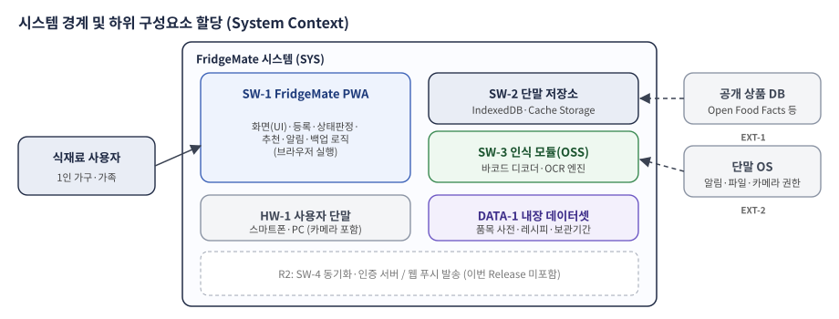
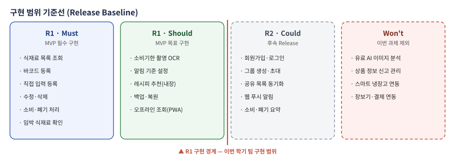

# FridgeMate System/Software 요구사항 명세서 (SyRS · SRS)

> 문서번호 FM-SRS-001 · v1.0 (중간 제출본) · 2026-10-15 · 냉장고팀
> 개발 단계: ② System Requirements Analysis (1부 SyRS) · ③ Software Requirements Analysis (2부 SRS)

## 문서관리 정보

| 항목 | 내용 |
|---|---|
| 프로젝트명 | FridgeMate: OSS 기반 냉장고 식재료·소비기한 관리 서비스 |
| 문서명 | System/Software Requirements Specification (기능·비기능 요구사항 포함) |
| 문서번호 / 버전 | FM-SRS-001 / v1.0 (중간 제출본) |
| 개발 단계 | 1부 System Requirements Analysis (SyRS), 2부 Software Requirements Analysis (SRS) |
| 관련 Issue | [Issue #4] 기능 요구사항 ([GitHub #12](https://github.com/jsj2026/fridgemate/issues/12)), [Issue #5] 비기능·데이터·인터페이스 요구사항 ([GitHub #13](https://github.com/jsj2026/fridgemate/issues/13)) |
| 입력 문서 | 프로젝트 정의서, User Class 정의서, 운용개념기술서(FM-OCD-001), Use Case 시나리오(FM-UCS-001), 기존 요구사항 초안 v0.1 |
| 작성 기준 | 강의자료「요구사항 분석」 SyRS·SRS 구조, ISO/IEC/IEEE 29148:2018, 교수자 샘플(통합 요구사항 명세서) |
| 문서 경로 | `docs/requirements/system-software-requirements-specification.md` |
| 작성 / 검토 | 냉장고팀 / Product Owner(이정남)·교수자 |

본 문서는 Product Backlog와 함께 관리하는 Living Requirements 문서이다. 요구사항을 변경할 때는 기존 내용을 덮어쓰지 않고 12장의 변경관리 절차에 따라 변경 Issue, 사유, 영향분석, 승인자를 기록한다.

### 변경기록

| 버전 | 일자 | 변경 내용 | 작성 | 승인 |
|---|---|---|---|---|
| v0.1 | 2026-10-08 | 기능 요구사항(FR-001~059), 비기능·데이터(NFR·DR), 인터페이스(IR) 초안을 각각 작성 | 이석환, 이지선 | 이정남 |
| v1.0 | 2026-10-15 | SyRS·SRS 통합, MoSCoW 우선순위와 구현 Release(R1/R2) 기준선 도입, R1을 서버 없는 PWA로 범위 조정(CR-01), ID 체계 정리(기존 ID 병기) | 냉장고팀 | 검토 예정 |

[TOC]

## 1. 요구사항 작성·관리 원칙

### 1.1 요구사항 문장 원칙

강의자료의 "효과적인 요구사항의 특성"과 "사용하지 말아야 할 용어 체크리스트"를 적용한다.

- 요구사항은 "시스템은 ~해야 한다" 형식으로 쓰고, 한 요구사항에는 하나의 검증 대상만 둔다.
- "빠르게, 적절한, 충분히, 여러, 약, 등"과 같은 주관적·열린 표현을 쓰지 않고 수치·범위·목록으로 쓴다.
- 구현 방법(HOW)이 아닌 시스템이 해야 할 일(WHAT)을 쓴다. 특정 OSS 제품은 예시로만 표기한다.
- 모든 요구사항은 시험(T)·시연(D)·분석(A)·검사(I) 중 하나 이상으로 검증할 수 있어야 한다.

### 1.2 우선순위와 구현 Release

| 우선순위 | Release | 의미 | 이번 학기 처리 |
|---|---|---|---|
| Must | R1 | MVP에 반드시 포함 | 구현·시험 필수 |
| Should | R1 | MVP 목표. 일정 위험 시 PO 승인 후 R2로 이월 가능 | 구현 목표 |
| Could | R2 | 후속 Release | 요구사항만 정의 |
| Won't | 제외 | 이번 과제 범위에서 제외 | 사유만 기록 |

> 기존 초안의 P0/P1/P2는 각각 Must/Should/Could를 기본으로 대응시키되, 7장의 범위 기준선 검토 결과에 따라 일부 항목을 조정했다(기존 ID 열 참조).

### 1.3 검증방법

| 기호 | 검증방법 | 설명 |
|---|---|---|
| T | Test | 시험 입력과 기대 결과로 동적 시험 |
| D | Demonstration | 실제 사용 흐름을 실행하여 시연 |
| A | Analysis | 측정값·로그·계산 결과 분석 |
| I | Inspection | 문서·코드·화면·설정 검사 |

### 1.4 요구사항 ID 체계

| 구분 | ID 형식 | 개발 단계 |
|---|---|---|
| 시스템 요구사항 | SYS-001 | System Requirements Analysis (1부) |
| 기능 요구사항 | FUN-001 | Software Requirements Analysis (2부) |
| 데이터 요구사항 | DAT-001 | 〃 |
| 외부 인터페이스 요구사항 | INT-001 | 〃 |
| 비기능 요구사항 | NFR-PERF/REL/SEC/USA/PORT/MNT/OSS-001 | 〃 |


# 1부. 시스템 요구사항 명세서 (SyRS)

## 2. 서론 (SyRS)

### 2.1 목적

1부는 FridgeMate를 사용자·단말·외부 데이터까지 포함한 **하나의 시스템**으로 보고, 시스템 수준에서 충족해야 할 능력·성능·인터페이스·제약을 정의한다. 각 시스템 요구사항은 하위 구성요소(SW·HW·DATA)에 할당되어 2부 소프트웨어 요구사항의 상위 근거가 된다.

### 2.2 범위

- **포함:** 식재료 등록(바코드·직접 입력·소비기한 OCR), 보관 위치별 조회, 소비기한 상태 판정과 임박 안내, 소비·폐기 처리와 이력, 레시피 추천, 백업·복원, 오프라인 사용
- **R2로 정의만:** 회원·로그인, 냉장고 그룹 공유와 동기화, 웹 푸시, 월별 요약
- **제외:** 스마트 냉장고(IoT 센서·카메라) 연동, 장보기·결제 연동, 유료 AI 이미지 분석, 영양 성분 분석, 앱스토어 네이티브 앱

### 2.3 정의 및 약어

| 용어 | 정의 |
|---|---|
| 소비기한 | 식품에 표시된, 섭취해도 안전한 기한. 본 시스템은 사용자가 입력한 날짜를 기준으로만 판단한다 |
| D-day | 단말 로컬 날짜 기준 오늘부터 소비기한까지 남은 일수 (당일 0, 지나면 음수) |
| 임박 | D-day가 1 이상, 임박 기준일(기본 3) 이하인 상태 |
| MVP / R1 | 이번 학기에 구현하는 최소 기능 제품 / 첫 번째 Release |
| PWA | 브라우저에서 실행되고 홈 화면 설치·오프라인 동작이 가능한 웹 앱 |
| OCR | 이미지 속 문자를 인식하는 기술 (Optical Character Recognition) |
| p95 | 측정값의 95%가 해당 값 이하인 지점 |

### 2.4 참조 문헌

| No. | 문서 | 활용 |
|---|---|---|
| 1 | 강의자료「OSS 기반 SW 개발방법론 — 요구사항 분석」(최태봉) | SyRS·SRS 구조, 품질 기준, 정의방법 |
| 2 | ISO/IEC/IEEE 29148:2018 Requirements engineering | 요구사항 작성·속성 기준 |
| 3 | FridgeMate 프로젝트 정의서 v0.1 | 목표(OBJ-01~05), 범위, 제약 |
| 4 | FridgeMate 운용개념기술서 FM-OCD-001 | 운용 시나리오(OS-01~06), 운용 정책 |
| 5 | FridgeMate Use Case 시나리오 FM-UCS-001 | Use Case(USE-01~18), 시나리오(SCN-01~07) |
| 6 | 교수자 샘플: 통합 요구사항 명세서, 운용개념기술서, Use Case Diagram | 문서 형식 |

## 3. 시스템 개요

### 3.1 시스템 맥락과 구성요소



<p class="fig">그림 1. FridgeMate 시스템 경계와 하위 구성요소</p>

| 구성요소 ID | 구성요소 | 유형 | 역할 | Release |
|---|---|---|---|---|
| SW-1 | FridgeMate PWA | 소프트웨어 | 화면, 등록, 상태 판정, 추천, 알림, 백업 로직 | R1 |
| SW-2 | 단말 저장소 | 소프트웨어(브라우저) | 식재료·이력·설정·캐시 저장 (IndexedDB 등) | R1 |
| SW-3 | 인식 모듈 | 소프트웨어(OSS) | 바코드 디코딩, OCR 문자 인식 | R1 |
| HW-1 | 사용자 단말 | 하드웨어 | 스마트폰·PC, 카메라 | R1 |
| DATA-1 | 내장 데이터셋 | 데이터 | 품목 사전, 분류별 권장 보관기간, 레시피 | R1 |
| EXT-1 | 공개 상품 DB | 외부 시스템 | 바코드 → 상품명·분류 | R1 |
| EXT-2 | 단말 OS | 외부 시스템 | 알림 표시, 파일 저장, 카메라 권한 | R1 |
| SW-4 | 동기화·인증 서버, 웹 푸시 | 소프트웨어(서버) | 가족 공유, 로그인, 푸시 발송 | R2 |

### 3.2 시스템 기능 개요

| 기능 그룹 | 설명 | 관련 Use Case |
|---|---|---|
| F1 보관 현황 조회 | 보관 위치별 목록, D-day·상태 표시, 정렬·검색 | USE-01 |
| F2 식재료 등록 | 바코드, 직접 입력(자동완성·기본값), 소비기한 OCR | USE-02~04 |
| F3 식재료 관리 | 수정·삭제, 소비·폐기 처리와 이력 | USE-05~06 |
| F4 임박 안내 | 상태 판정, 상단 요약, 단말 알림, 기준 설정 | USE-07~08 |
| F5 레시피 추천 | 임박 재료 우선 추천, 보유·부족 재료 표시 | USE-09 |
| F6 데이터 보호 | 백업·복원, 오프라인 동작 | USE-10 |
| F7 공유 (R2) | 로그인, 그룹 초대, 동기화, 웹 푸시, 월별 요약 | USE-11~15 |

### 3.3 사용자 클래스

| ID | User Class | 특성 | R1 사용 범위 |
|---|---|---|---|
| UC-01 | 1인 가구 사용자 | 주 1~2회 몰아서 장보기, 한 번에 5~15개 등록, 입력이 번거로우면 사용 중단 | 전체 R1 기능 |
| UC-02 | 가족 공유 사용자 | 연령·숙련도 다양, 단순한 화면 선호 | 단말별 개인 사용 (공유는 R2) |
| UC-03 | 냉장고 그룹 관리자 | 구성원 초대·권한 관리 | R2 |
| UC-04 | 서비스 관리자 | 상품 정보·서비스 운영 | 제외 (R1은 서버 없음) |
| UC-05 | Product Owner·교수자 | 산출물 검토·수용 | Sprint Review |

### 3.4 제약사항과 가정

| 구분 | 내용 |
|---|---|
| 제약 C-1 | 이번 학기 수행기간과 팀원 3명(수업 외 시간)으로 구현 가능한 범위만 R1에 포함한다 |
| 제약 C-2 | 무료 OSS와 이용조건이 확인된 공개 데이터만 사용한다 |
| 제약 C-3 | R1은 서버 비용·운영 부담이 없도록 정적 호스팅(GitHub Pages)으로 배포한다 |
| 제약 C-4 | 개인정보는 R1에서 수집하지 않는다 |
| 가정 A-1 | 사용자는 카메라가 있는 스마트폰 또는 PC 브라우저를 사용한다 |
| 가정 A-2 | 국내 가공식품 중 일부만 공개 상품 DB에 등록되어 있으므로, 직접 입력 경로가 항상 필요하다 |
| 가정 A-3 | 소비기한 인쇄 형식은 제품마다 다르므로 OCR 결과는 사용자 확인을 전제로 한다 |

## 4. 시스템 요구사항

| ID | 시스템 요구사항 | 출처 | 할당 | 우선순위 | Release | 검증 |
|---|---|---|---|---|---|---|
| SYS-001 | 시스템은 사용자가 보유 식재료를 냉장·냉동·실온 보관 위치별로 확인할 수 있게 해야 한다. | PB-01, OBJ-04 | SW-1, SW-2 | Must | R1 | D |
| SYS-002 | 시스템은 바코드 스캔, 직접 입력, 소비기한 촬영의 3가지 등록 수단을 제공해야 한다. | PB-05, OBJ-01 | SW-1, SW-3, HW-1, EXT-1 | Must | R1 | D |
| SYS-003 | 시스템은 소비기한까지 남은 일수로 식재료 상태를 판정하고 임박 식재료를 사용자에게 알려야 한다. | PB-02, OBJ-03 | SW-1, EXT-2 | Must | R1 | T |
| SYS-004 | 시스템은 식재료의 소비·폐기 처리와 처리 이력을 관리해야 한다. | PB-03 | SW-1, SW-2 | Must | R1 | T |
| SYS-005 | 시스템은 보유 식재료 중 임박 재료를 우선 사용하는 레시피를 추천해야 한다. | 정의서 8.1 | SW-1, DATA-1 | Should | R1 | D |
| SYS-006 | 시스템은 사용자 데이터를 파일로 백업하고 복원할 수 있어야 한다. | C-3 (서버 없음) | SW-1, EXT-2 | Should | R1 | T |
| SYS-007 | 시스템은 네트워크 연결 없이 조회·직접 입력 등록·수정·처리 기능을 제공해야 한다. | OCD OM-02 | SW-1, SW-2 | Should | R1 | T |
| SYS-008 | 시스템은 공개 상품 DB에 있는 상품을 바코드 스캔 시작부터 10초 이내에 등록할 수 있게 해야 한다. | OBJ-01 | SW-1, SW-3, EXT-1 | Must | R1 | T |
| SYS-009 | 시스템은 식재료 300건 저장 상태에서 목록을 2초 이내에 표시해야 한다. | OBJ-04 | SW-1, SW-2 | Must | R1 | T |
| SYS-010 | 시스템은 국내 가공식품 바코드를 90% 이상 인식해야 한다. | OBJ-02 | SW-3, HW-1 | Must | R1 | T/A |
| SYS-011 | 시스템은 임박·오늘까지 상태 식재료를 안내에서 누락하지 않아야 한다. | OBJ-03 | SW-1 | Must | R1 | T |
| SYS-012 | 시스템은 외부 상품 DB와 HTTPS로 연동하고, 장애·미등록 시 직접 입력으로 등록을 마칠 수 있게 해야 한다. | 정의서 12 위험 | SW-1, EXT-1 | Must | R1 | T |
| SYS-013 | 시스템은 Android·iOS 스마트폰과 PC의 웹 브라우저에서 별도 설치 없이 실행되고 홈 화면에 설치할 수 있어야 한다. | 정의서 8.2 | SW-1, HW-1 | Must | R1 | D |
| SYS-014 | 시스템은 R1에서 개인정보를 수집하지 않고 사용자 데이터를 사용자 단말에만 저장해야 한다. | C-4 | SW-1, SW-2 | Must | R1 | I |
| SYS-015 | 시스템은 라이선스와 이용조건이 확인된 무료 OSS와 공개 데이터만 사용해야 한다. | C-2, OBJ-05 | 전체 | Must | R1 | I |
| SYS-016 | 시스템은 가족 구성원이 하나의 냉장고 목록을 공유하고 변경 사항을 10초 이내에 동기화할 수 있어야 한다. | PB-06 | SW-4 | Could | R2 | T |
| SYS-017 | 시스템은 앱을 실행하지 않아도 정해진 시각에 임박 알림을 보낼 수 있어야 한다. | PB-02 | SW-4 | Could | R2 | T |

### 4.1 시스템 요구사항 할당 매트릭스

| SYS ID | SW-1 PWA | SW-2 저장소 | SW-3 인식 | HW-1 단말 | DATA-1 | EXT-1 상품DB | EXT-2 OS | SW-4 서버(R2) | 2부 SW 요구사항 |
|---|---|---|---|---|---|---|---|---|---|
| SYS-001 | ● | ● | | | | | | | FUN-001~006 |
| SYS-002 | ● | | ● | ● | ● | ● | | | FUN-007~022 |
| SYS-003 | ● | | | | | | ● | | FUN-031~036 |
| SYS-004 | ● | ● | | | | | | | FUN-025~030 |
| SYS-005 | ● | | | | ● | | | | FUN-037~040 |
| SYS-006 | ● | | | | | | ● | | FUN-041~043 |
| SYS-007 | ● | ● | | | | | | | FUN-044~045 |
| SYS-008~010 | ● | ● | ● | ● | | ● | | | NFR-PERF-001~003, NFR-REL-001 |
| SYS-011 | ● | | | | | | | | NFR-REL-002 |
| SYS-012 | ● | | | | | ● | | | FUN-009~010, INT-003~004, NFR-REL-003 |
| SYS-013 | ● | | | ● | | | | | NFR-PORT-001~004 |
| SYS-014 | ● | ● | | | | | | | DAT-011, NFR-SEC-002~003 |
| SYS-015 | ● | ● | ● | | ● | ● | | | NFR-OSS-001~005 |
| SYS-016~017 | | | | | | | | ● | FUN-047~052 |


# 2부. 소프트웨어 요구사항 명세서 (SRS)

## 5. 서론 (SRS)

### 5.1 목적

2부는 1부의 시스템 요구사항을 FridgeMate PWA(SW-1~3)가 구현해야 할 **소프트웨어 요구사항**으로 상세화한다. 개발팀(구현), Reviewer(검토), Product Owner·교수자(수용 판단)가 같은 기준으로 사용하며, Sprint Backlog의 User Story와 시험 케이스는 본 문서의 ID를 참조한다.

### 5.2 범위

R1 대상 소프트웨어는 사용자 브라우저에서 실행되는 단일 PWA이며 서버 컴포넌트를 갖지 않는다. 외부 연동은 공개 상품 DB 조회(HTTPS)뿐이다. R2 요구사항은 범위를 명확히 하기 위해 함께 정의하지만 이번 학기 구현·시험 대상이 아니다.

## 6. 전체 설명

### 6.1 제품 관점

FridgeMate는 기존 메모·가계부 앱을 대체하는 독립 제품이다. 사용자 단말의 카메라·저장소·알림 기능을 브라우저 표준 API로 사용하고, 바코드 디코딩과 OCR은 OSS 라이브러리를 브라우저 안에서 실행한다. 상품명은 공개 상품 DB에서 가져오고 결과를 단말에 캐시한다.

### 6.2 제품 기능

제품 기능은 Use Case Diagram(FM-UCS-001 그림 1)과 같다. R1은 USE-01~10, R2는 USE-11~15이다.

### 6.3 사용자 특성

3.3절의 User Class를 따른다. 화면 설계 시 숙련도가 낮은 가족 사용자를 기준으로 하여, 쉬운 우리말 문구·큰 터치 영역·색상과 문자 병행 표시를 적용한다.

### 6.4 제약사항과 가정

3.4절의 C-1~C-4, A-1~A-3을 따른다. 추가로 다음을 가정한다.

- D-day는 단말 로컬 날짜(Asia/Seoul 기준 사용 환경)로 계산한다.
- iOS Safari의 단말 알림은 홈 화면에 설치한 PWA에서만 지원되므로, 알림은 앱 내 표시를 기본으로 한다.

## 7. 구현 범위 기준선 (MVP Baseline)

팀 개발에서 가장 큰 위험인 "요구사항을 어디까지 정의하고 어디까지 구현할 것인가"에 대한 팀의 결정이다. **요구사항은 전체 서비스 기준으로 정의하되, 이번 학기 구현은 R1으로 한정한다.**



<p class="fig">그림 2. 구현 범위 기준선 — 빨간 선 왼쪽(R1)만 이번 학기에 구현</p>

### 7.1 범위 결정 원칙

1. **핵심 문제 우선:** 프로젝트 정의서의 핵심 문제(PB-01 보유 파악, PB-02 기한 관리, PB-03 폐기, PB-05 등록 번거로움)를 해결하는 기능을 Must로 한다.
2. **서버 없는 R1:** 서버가 필요한 기능(로그인·공유·웹 푸시)은 인증·개인정보·운영비·보안 점검이 함께 필요하므로 R2로 분리한다. R1은 단말 저장 + 백업 파일로 데이터를 보호한다.
3. **무료·검증 가능:** 유료 API(AI 이미지 분석)와 하드웨어(IoT)는 제외한다. OCR은 브라우저에서 동작하는 무료 OSS까지만 R1에 넣는다.
4. **측정 가능한 완료:** R1에 넣은 모든 Must 요구사항은 시험 케이스로 Pass/Fail을 판정할 수 있어야 한다.
5. **이월 규칙:** Should는 Sprint Review 시점에 일정 위험이 있으면 PO 승인으로 R2로 이월한다. Must의 이월은 범위 변경(12장)으로 처리한다.

### 7.2 Release별 요구사항 수

| 구분 | R1 Must | R1 Should | R2 Could | Won't | 합계 |
|---|---|---|---|---|---|
| 시스템 요구사항 (SYS) | 12 | 3 | 2 | 0 | 17 |
| 기능 요구사항 (FUN) | 17 | 26 | 8 | 3 | 54 |
| 데이터 요구사항 (DAT) | 5 | 6 | 1 | 0 | 12 |
| 인터페이스 요구사항 (INT) | 5 | 4 | 3 | 0 | 12 |
| 비기능 요구사항 (NFR) | 21 | 15 | 1 | 0 | 37 |
| **합계** | **60** | **54** | **15** | **3** | **132** |

이번 학기 구현·시험 대상은 R1의 114개(Must 60, Should 54)이며, 이 중 Must 60개는 R1 완료 조건이다. R2 15개와 Won't 3개는 범위 경계를 명확히 하기 위해 정의만 한다.

### 7.3 R1에서 구현하지 않는 항목과 사유

| 항목 | 결정 | 사유 | 대체 수단 (R1) |
|---|---|---|---|
| 회원가입·로그인 | R2 | 서버·개인정보 처리 필요 | 로그인 없이 단말에서 사용 |
| 냉장고 그룹·가족 공유·동기화 | R2 | 동기화 서버와 충돌 처리 필요 | 백업 파일 공유로 기기 간 이동 |
| 웹 푸시 알림 | R2 | 푸시 발송 서버 필요, iOS 제약 | 앱 실행 시 상단 요약 + 단말 알림 |
| 소비·폐기 월별 요약 | R2 | 핵심 문제 해결과 직접 관련이 낮음 | 처리 이력은 R1에서 저장 |
| 제품 앞면 사진으로 상품명 인식 | R2 | 인식률 검증 필요, 바코드로 대부분 대체 | 바코드·자동완성 |
| AI 이미지 분석(유료 API) | Won't | 비용·API 키 노출·개인정보 위험 | 무료 OCR + 사용자 확인 |
| 상품 정보 신고·관리자 기능 | Won't | 관리 서버 필요 | 사용자 입력 상품명을 단말에 저장 |

## 8. 세부 요구사항

### 8.1 기능 요구사항

#### F1. 식재료 목록 조회 (USE-01)

| ID | 기능 요구사항 | 출처 | 우선순위 | Release | 검증 | 기존 ID |
|---|---|---|---|---|---|---|
| FUN-001 | 시스템은 식재료를 냉장·냉동·실온 보관 위치 탭으로 구분하여 표시해야 한다. | USE-01, SYS-001 | Must | R1 | D/T | FR-020 |
| FUN-002 | 시스템은 각 식재료의 품목명, 수량과 단위, 소비기한, D-day를 목록에 표시해야 한다. | USE-01 | Must | R1 | T | FR-021 |
| FUN-003 | 시스템은 식재료 상태를 보관(D-7 이상), 여유(D-4~D-6), 임박(D-1~임박 기준일), 오늘까지(D-0), 기한 경과(D-day 음수)로 판정해야 한다. | SCN-04, SYS-003 | Must | R1 | T | CONOPS 8.1 |
| FUN-004 | 시스템은 식재료 상태를 색상과 문자 라벨("임박 D-2", "오늘까지", "기한 지남")로 함께 표시해야 한다. | SCN-04 | Must | R1 | I | FR-022 |
| FUN-005 | 시스템은 목록을 소비기한 임박순(기본값), 등록순, 이름순으로 정렬할 수 있게 해야 한다. | USE-01 | Should | R1 | T | FR-023 |
| FUN-006 | 시스템은 품목명의 부분 일치로 식재료를 검색할 수 있게 해야 한다. | USE-01 | Should | R1 | T | FR-024 |

#### F2. 바코드 등록 (USE-02, SCN-01)

| ID | 기능 요구사항 | 출처 | 우선순위 | Release | 검증 | 기존 ID |
|---|---|---|---|---|---|---|
| FUN-007 | 시스템은 단말 카메라 영상에서 EAN-13, EAN-8, UPC-A 바코드를 인식해야 한다. | SCN-01 | Must | R1 | T/D | FR-011 |
| FUN-008 | 시스템은 인식한 바코드로 상품 정보 캐시와 공개 상품 DB를 차례로 조회하여 상품명과 분류를 등록 화면에 채워야 한다. | SCN-01 | Must | R1 | T | FR-012 |
| FUN-009 | 시스템은 바코드가 10초 동안 인식되지 않거나 카메라 권한이 거부되면 바코드 번호 직접 입력 화면을 제공해야 한다. | SCN-01 E1 | Must | R1 | T | FR-013 |
| FUN-010 | 시스템은 공개 상품 DB에 상품 정보가 없거나 5초 안에 응답이 없으면 상품명 직접 입력으로 전환해야 한다. | SCN-01 E2 | Must | R1 | T | FR-014 |
| FUN-011 | 시스템은 사용자가 입력한 상품명을 바코드와 함께 단말에 저장하여 같은 바코드의 다음 스캔에서 자동으로 채워야 한다. | SCN-01 E2 | Should | R1 | T | FR-015 |
| FUN-012 | 시스템은 같은 바코드의 미처리 식재료가 있으면 "새로 추가"와 "수량 더하기" 중 하나를 사용자가 선택하게 해야 한다. | SCN-01 A2 | Should | R1 | T | FR-019 |

#### F3. 직접 입력 등록 (USE-03, SCN-02)

| ID | 기능 요구사항 | 출처 | 우선순위 | Release | 검증 | 기존 ID |
|---|---|---|---|---|---|---|
| FUN-013 | 시스템은 바코드 없이 품목명, 수량, 단위, 보관 위치, 소비기한을 입력하여 식재료를 등록할 수 있게 해야 한다. | SCN-02 | Must | R1 | T | FR-016 |
| FUN-014 | 시스템은 품목명 입력 시 내장 품목 사전에서 일치하는 품목을 최대 5개 자동완성으로 제안해야 한다. | SCN-02 | Should | R1 | T/D | FR-017 |
| FUN-015 | 시스템은 선택한 품목 분류의 권장 보관기간으로 소비기한 기본값과 기본 보관 위치를 채워야 한다. | SCN-02 | Should | R1 | T | FR-018 |
| FUN-016 | 시스템은 품목명·수량·보관 위치·소비기한 중 하나라도 비어 있거나 수량이 0 이하이면 저장하지 않고 해당 입력칸과 수정 방법을 표시해야 한다. | SCN-02 E1 | Must | R1 | T | 신규 |

#### F4. 소비기한 촬영 인식 (USE-04, SCN-03)

| ID | 기능 요구사항 | 출처 | 우선순위 | Release | 검증 | 기존 ID |
|---|---|---|---|---|---|---|
| FUN-017 | 시스템은 카메라 촬영 또는 단말 사진 선택으로 소비기한 이미지를 입력받아야 한다. | SCN-03 | Should | R1 | T | FR-050, FR-051 |
| FUN-018 | 시스템은 브라우저 안에서 동작하는 OCR 엔진으로 이미지의 숫자와 날짜 구분 문자를 인식해야 한다. | SCN-03 | Should | R1 | T | FR-053 |
| FUN-019 | 시스템은 인식 문자열에서 날짜 후보를 추출하고 "제조" 표기가 붙은 날짜를 소비기한 후보에서 제외해야 한다. | SCN-03 | Should | R1 | T | FR-055 |
| FUN-020 | 시스템은 날짜 후보가 없거나 2개 이상이면 소비기한 칸을 빈칸으로 두고 후보 목록에서 사용자가 선택하게 해야 한다. | SCN-03 E2 | Should | R1 | T | FR-055 |
| FUN-021 | 시스템은 사용자가 확인·수정하고 "적용"을 누른 경우에만 OCR 결과를 등록 화면에 반영해야 한다. | SCN-03 | Should | R1 | T | FR-057, FR-058 |
| FUN-022 | 시스템은 OCR 인식에 실패하면 실패 안내와 함께 수동 입력으로 전환해야 한다. | SCN-03 E1 | Should | R1 | T | FR-059 |
| FUN-023 | 시스템은 제품 앞면 사진에서 상품명을 인식해야 한다. | 이석환 제안 | Could | R2 | T | FR-049 |
| FUN-024 | 시스템은 사용자가 요청하면 제품 사진을 AI 이미지 분석 서비스로 보내 상품명과 소비기한을 추출해야 한다. | 이석환 제안 | Won't | 제외 | - | FR-054 |

#### F5. 식재료 수정·삭제 (USE-05)

| ID | 기능 요구사항 | 출처 | 우선순위 | Release | 검증 | 기존 ID |
|---|---|---|---|---|---|---|
| FUN-025 | 시스템은 식재료의 품목명, 수량, 소비기한, 보관 위치를 수정할 수 있게 해야 한다. | USE-05 | Must | R1 | T | FR-025 |
| FUN-026 | 시스템은 삭제 전 확인 대화상자를 표시하고 사용자가 확인한 경우에만 식재료를 삭제해야 한다. | USE-05 | Must | R1 | T | FR-026 조정 |

#### F6. 소비·폐기 처리 (USE-06, SCN-04)

| ID | 기능 요구사항 | 출처 | 우선순위 | Release | 검증 | 기존 ID |
|---|---|---|---|---|---|---|
| FUN-027 | 시스템은 식재료를 "소비" 또는 "폐기"로 처리하고 현재 목록에서 제외해야 한다. | SCN-04 | Must | R1 | T | FR-027 |
| FUN-028 | 시스템은 처리 시 품목명, 처리 유형, 처리 수량, 처리 일시를 이력으로 저장해야 한다. | SCN-04 | Must | R1 | T | FR-030 |
| FUN-029 | 시스템은 일부 수량만 처리하면 남은 수량을 갱신하고 식재료를 목록에 유지해야 한다. | SCN-04 A3 | Should | R1 | T | FR-029 |
| FUN-030 | 시스템은 여러 식재료를 선택하여 한 번에 소비 또는 폐기로 처리할 수 있게 해야 한다. | SCN-04 A4 | Should | R1 | T/D | FR-028 |

#### F7. 임박 식재료 확인 (USE-07, SCN-04)

| ID | 기능 요구사항 | 출처 | 우선순위 | Release | 검증 | 기존 ID |
|---|---|---|---|---|---|---|
| FUN-031 | 시스템은 앱 실행 시와 실행 중 단말 날짜가 바뀐 시점에 모든 식재료의 상태를 다시 판정해야 한다. | SCN-04 | Must | R1 | T | FR-032 조정 |
| FUN-032 | 시스템은 임박·오늘까지 상태 식재료의 개수와 품목명을 목록 화면 상단 요약 영역에 표시해야 한다. | SCN-04 | Must | R1 | T | FR-037 |
| FUN-033 | 시스템은 기한 경과 식재료를 상단 요약 영역에 "확인 필요"로 별도 표시해야 한다. | SCN-04 A2 | Must | R1 | T | FR-038 |
| FUN-034 | 시스템은 단말 알림 권한이 허용되어 있으면 하루 1회, 그날 첫 실행 시 임박 품목 요약을 단말 알림으로 표시해야 한다. | SCN-04 A1 | Should | R1 | T/D | FR-033 조정 |

#### F8. 알림 기준 설정 (USE-08)

| ID | 기능 요구사항 | 출처 | 우선순위 | Release | 검증 | 기존 ID |
|---|---|---|---|---|---|---|
| FUN-035 | 시스템은 사용자가 임박 기준일을 1~7일 범위에서 설정할 수 있게 해야 하며, 기본값은 3일이어야 한다. | SCN-04 A5 | Should | R1 | T | FR-035 |
| FUN-036 | 시스템은 사용자가 단말 알림 사용 여부를 켜고 끌 수 있게 해야 한다. | SCN-04 A5 | Should | R1 | T | FR-035 |

#### F9. 레시피 추천 (USE-09, SCN-05)

| ID | 기능 요구사항 | 출처 | 우선순위 | Release | 검증 | 기존 ID |
|---|---|---|---|---|---|---|
| FUN-037 | 시스템은 보유 식재료와 내장 레시피 데이터셋의 재료를 품목명으로 비교하여 보유 재료를 1개 이상 사용하는 레시피를 추천해야 한다. | SCN-05 | Should | R1 | T | FR-039 |
| FUN-038 | 시스템은 추천 레시피를 임박·오늘까지 재료 사용 수가 많은 순으로 정렬해야 한다. | SCN-05 | Should | R1 | T | FR-040 |
| FUN-039 | 시스템은 레시피별로 보유 재료와 부족한 재료를 구분하여 표시해야 한다. | SCN-05 | Should | R1 | T | FR-041 |
| FUN-040 | 시스템은 추천할 레시피가 없으면 안내 문구를 표시해야 한다. | SCN-05 E1 | Should | R1 | T | FR-042 |

#### F10. 백업·복원과 오프라인 (USE-10, SCN-06)

| ID | 기능 요구사항 | 출처 | 우선순위 | Release | 검증 | 기존 ID |
|---|---|---|---|---|---|---|
| FUN-041 | 시스템은 식재료, 처리 이력, 설정 전체를 하나의 JSON 백업 파일로 내보내야 한다. | SCN-06 | Should | R1 | T | 신규 |
| FUN-042 | 시스템은 백업 파일을 가져올 때 파일 형식과 스키마 버전을 검증하고, 검증에 실패하면 기존 데이터를 변경하지 않아야 한다. | SCN-06 E1 | Should | R1 | T | 신규 |
| FUN-043 | 시스템은 백업을 가져올 때 "합치기"와 "덮어쓰기" 중 선택하게 하고, 덮어쓰기는 삭제될 건수를 보여준 뒤 확인을 받아야 한다. | SCN-06 A1 | Should | R1 | T | 신규 |
| FUN-044 | 시스템은 네트워크 연결이 없어도 목록 조회, 직접 입력 등록, 수정, 소비·폐기 처리를 제공해야 한다. | SYS-007 | Should | R1 | T | FR-043, FR-044 |
| FUN-045 | 시스템은 오프라인 상태에서 바코드 상품 조회가 필요하면 오프라인 안내 후 상품명 직접 입력으로 전환해야 한다. | SCN-01 E3 | Should | R1 | T | FR-045 |

#### F11. 후속 Release 및 제외 기능

| ID | 기능 요구사항 | 출처 | 우선순위 | Release | 검증 | 기존 ID |
|---|---|---|---|---|---|---|
| FUN-046 | 시스템은 월별 소비·폐기 품목 수와 폐기 비율을 요약해 보여줘야 한다. | USE-11 | Could | R2 | T | FR-031 |
| FUN-047 | 시스템은 이메일과 비밀번호로 회원가입과 로그인을 제공해야 한다. | USE-12 | Could | R2 | T | FR-001 |
| FUN-048 | 시스템은 그룹 관리자가 생성 후 7일간 유효한 초대 링크로 구성원을 초대할 수 있게 해야 한다. | USE-13 | Could | R2 | T | FR-006, FR-007 |
| FUN-049 | 시스템은 같은 그룹 구성원의 식재료 변경을 10초 이내에 다른 구성원 화면에 반영해야 한다. | USE-14 | Could | R2 | T | FR-009 |
| FUN-050 | 시스템은 식재료별 등록자, 마지막 수정자, 수정 시각을 표시해야 한다. | USE-14 | Could | R2 | T | FR-010 |
| FUN-051 | 시스템은 사용자가 정한 시각에 임박 품목 요약을 웹 푸시로 보내야 한다. | USE-15 | Could | R2 | T | FR-032, FR-033 |
| FUN-052 | 시스템은 그룹 관리자가 구성원을 제외할 수 있게 해야 한다. | USE-13 | Could | R2 | T | FR-008 |
| FUN-053 | 시스템은 사용자가 잘못된 상품 정보를 신고하고 서비스 관리자가 이를 수정할 수 있게 해야 한다. | USE-16 | Won't | 제외 | - | FR-046, FR-047 |
| FUN-054 | 시스템은 서비스 관리자가 외부 연동 상태와 알림 발송 결과를 조회할 수 있게 해야 한다. | USE-16 | Won't | 제외 | - | FR-048 |

### 8.2 데이터 요구사항

| ID | 데이터 요구사항 | 출처 | 우선순위 | Release | 검증 |
|---|---|---|---|---|---|
| DAT-001 | 식재료 레코드는 itemId(UUID), name, category, barcode(선택), quantity, unit, storage, expiryDate, createdAt, updatedAt을 포함해야 한다. | USE-02~03 | Must | R1 | I/T |
| DAT-002 | expiryDate는 YYYY-MM-DD 형식으로 저장하고, D-day는 단말 로컬 날짜 기준 정수로 계산해야 한다. | FUN-003 | Must | R1 | T |
| DAT-003 | storage는 "냉장", "냉동", "실온" 중 하나여야 한다. | FUN-001 | Must | R1 | T |
| DAT-004 | quantity는 0보다 큰 숫자여야 하며, 처리로 0이 되면 해당 식재료를 소비 완료로 처리해야 한다. | FUN-029 | Should | R1 | T |
| DAT-005 | 처리 이력 레코드는 historyId, itemId, name, type(소비·폐기), quantity, processedAt을 포함하고 처리일로부터 1년간 보존해야 한다. | FUN-028 | Must | R1 | I/T |
| DAT-006 | 상품 정보 캐시는 barcode, name, category, source, fetchedAt을 포함하고, fetchedAt으로부터 30일이 지나면 다시 조회해야 한다. | FUN-008 | Should | R1 | T |
| DAT-007 | 외부 데이터(상품 정보·레시피)는 출처명을 함께 저장하고 화면에 표시해야 한다. | NFR-OSS-005 | Should | R1 | I |
| DAT-008 | 설정 레코드는 임박 기준일, 단말 알림 사용 여부, 마지막 알림 표시일을 포함해야 한다. | FUN-034~036 | Should | R1 | I |
| DAT-009 | 내장 데이터셋은 품목 사전 200개 이상(품목명·분류·권장 보관기간·기본 보관 위치)과 레시피 50개 이상(레시피명·재료·조리 요약·출처)을 포함해야 한다. | FUN-014, FUN-037 | Should | R1 | I |
| DAT-010 | 백업 파일은 schemaVersion, exportedAt, items, history, settings 필드를 가진 UTF-8 JSON이어야 한다. | FUN-041 | Should | R1 | I/T |
| DAT-011 | 시스템은 R1에서 이름·이메일·전화번호와 같은 개인 식별정보를 수집·저장하지 않아야 한다. | SYS-014 | Must | R1 | I |
| DAT-012 | 사용자 계정·냉장고 그룹 레코드(사용자 ID, 이메일, 비밀번호 해시, 그룹 ID, 구성원, 권한)를 서버에 저장해야 한다. | USE-12~14 | Could | R2 | I |

**식재료 레코드 예시 (DAT-001)**

```json
{
  "itemId": "6f1c2a0e-3b9d-4f6a-9a51-2c7e1d0b8f11",
  "name": "서울우유 1L",
  "category": "유제품",
  "barcode": "8801115114154",
  "quantity": 1,
  "unit": "개",
  "storage": "냉장",
  "expiryDate": "2026-10-18",
  "createdAt": "2026-10-15T19:20:00+09:00",
  "updatedAt": "2026-10-15T19:20:00+09:00"
}
```

### 8.3 외부 인터페이스 요구사항

| ID | 인터페이스 요구사항 | 출처 | 우선순위 | Release | 검증 |
|---|---|---|---|---|---|
| INT-001 | 시스템은 브라우저 카메라 API로 후면 카메라 영상을 받아 단말 안에서 처리하고, 영상·사진을 외부로 전송하지 않아야 한다. | 기존 IR-CAM-001, 004 | Must | R1 | T/I |
| INT-002 | 바코드 인식 모듈은 EAN-13, EAN-8, UPC-A 형식의 번호를 문자열로 반환해야 한다. | 기존 IR-CAM-002 | Must | R1 | T |
| INT-003 | 시스템은 공개 상품 DB를 HTTPS GET으로 조회하고, 5초 안에 응답이 없으면 실패로 처리해야 한다. | 기존 IR-PRD-001, IR-COM-004 | Must | R1 | T |
| INT-004 | 시스템은 공개 상품 DB의 이용조건(요청 식별 정보 표기, 호출 제한, 출처 표시)을 준수해야 한다. | 기존 IR-PRD-005 | Must | R1 | I |
| INT-005 | 시스템은 브라우저 영구 저장소(IndexedDB 또는 동등 기능)에 데이터를 저장하고, 저장 실패 시 원인과 조치를 안내해야 한다. | SYS-014 | Must | R1 | T |
| INT-006 | 시스템은 브라우저 Notification API로 단말 알림을 표시하고, 권한이 없으면 앱 내 표시만 사용해야 한다. | FUN-034 | Should | R1 | T |
| INT-007 | 시스템은 백업 파일을 `fridgemate-backup-YYYYMMDD.json` 이름으로 저장하고, 파일 선택 창으로 백업 파일을 불러와야 한다. | FUN-041 | Should | R1 | T |
| INT-008 | OCR 엔진 인터페이스는 이미지 1장을 입력받아 인식 문자열과 문자별 신뢰도를 반환해야 한다. | FUN-018 | Should | R1 | T |
| INT-009 | 화면은 하단 탭 4개(목록, 등록, 레시피, 설정)로 구성하고, 목록 화면에서 등록 화면까지 1회 터치로 이동할 수 있어야 한다. | NFR-USA-004 | Should | R1 | D |
| INT-010 | 서버 API는 `/api/v1` 경로와 UTF-8 JSON을 사용하고 오류 응답에 error_code, message를 포함해야 한다. | 기존 IR-COM-001~002 | Could | R2 | I/T |
| INT-011 | 인증 API는 로그인 성공 시 만료 시간이 있는 Token을 발급해야 한다. | 기존 IR-AUT-001 | Could | R2 | T |
| INT-012 | 서버는 Web Push 표준으로 알림 제목, 내용, 이동 화면 주소를 보내야 한다. | 기존 IR-PSH-001~002 | Could | R2 | T |

**공개 상품 DB 조회 결과 사용 예시 (INT-003)**

```json
{
  "barcode": "8801115114154",
  "name": "서울우유 1L",
  "category": "유제품",
  "source": "Open Food Facts",
  "fetchedAt": "2026-10-15T19:20:03+09:00"
}
```

### 8.4 비기능 요구사항

#### 8.4.1 성능

| ID | 비기능 요구사항 | 목표 수치·측정조건 | 우선순위 | Release | 검증 |
|---|---|---|---|---|---|
| NFR-PERF-001 | 공개 상품 DB에 있는 상품의 바코드 스캔 시작부터 저장 완료까지의 시간 | 10초 이내 (상품 10종, 시험 사용자 3명) | Must | R1 | T |
| NFR-PERF-002 | 바코드가 화면 안내선에 들어온 뒤 인식까지의 시간 | p95 3초 이내 (실내 조명, 스마트폰 2종) | Must | R1 | T |
| NFR-PERF-003 | 식재료 300건 저장 상태에서 앱 실행 후 목록 첫 표시 시간 | p95 2초 이내 | Must | R1 | T |
| NFR-PERF-004 | 공개 상품 DB 정상 응답 시 조회 결과의 등록 화면 반영 시간 | p95 3초 이내 | Should | R1 | T |
| NFR-PERF-005 | 소비기한 이미지 1장의 OCR 처리 시간 | p95 8초 이내 (출시 4년 이내 스마트폰) | Should | R1 | T |
| NFR-PERF-006 | 레시피 50개·식재료 30개 조건에서 추천 결과 표시 시간 | p95 2초 이내 | Should | R1 | T |

#### 8.4.2 신뢰성·정확도

| ID | 비기능 요구사항 | 목표 수치·측정조건 | 우선순위 | Release | 검증 |
|---|---|---|---|---|---|
| NFR-REL-001 | 국내 가공식품 바코드 인식(디코딩) 성공률 | 90% 이상 (시판 상품 50개) | Must | R1 | T/A |
| NFR-REL-002 | 상태 판정 정확도 | 시험 데이터 30건(경계값 포함) 판정 오류 0건 | Must | R1 | T |
| NFR-REL-003 | 상품 DB 장애·오프라인 시 직접 입력 등록, 조회, 처리 기능 동작 | 네트워크 차단 시험 3종 모두 Pass | Must | R1 | T |
| NFR-REL-004 | 앱 종료·브라우저 재시작 후 저장 데이터 보존 | 100건 저장 후 재시작 시 손실 0건 | Must | R1 | T |
| NFR-REL-005 | 백업 후 다른 브라우저에서 복원 시 데이터 일치 | 항목 수·필드 값 일치율 100% | Should | R1 | T |
| NFR-REL-006 | OCR 소비기한 추출 정확도 | 시험 이미지 30장 중 정답 추출 70% 이상, 미확인 자동 저장 0건 | Should | R1 | T/A |
| NFR-REL-007 | 공개 상품 DB 자동 채움 비율 측정 | 시판 상품 50개 측정·기록. 30% 미만이면 R2 국내 공공 식품 데이터 연동을 Must로 상향 검토 | Should | R1 | A |

#### 8.4.3 보안·개인정보

| ID | 비기능 요구사항 | 목표 수치·조건 | 우선순위 | Release | 검증 |
|---|---|---|---|---|---|
| NFR-SEC-001 | 모든 외부 통신 프로토콜 | HTTPS(TLS 1.2 이상) 100% | Must | R1 | I/T |
| NFR-SEC-002 | 카메라 영상·사진의 외부 전송 | 0건 (네트워크 로그 검사) | Must | R1 | I/T |
| NFR-SEC-003 | R1의 개인 식별정보 수집 항목 | 0개 | Must | R1 | I |
| NFR-SEC-004 | API 키·비밀정보의 저장소 커밋 | 0건 (저장소 검사) | Must | R1 | I |
| NFR-SEC-005 | R2 계정 보안 | 비밀번호 bcrypt 해시 저장, 5회 연속 실패 시 10분 잠금 | Could | R2 | T/I |

#### 8.4.4 사용성·접근성

| ID | 비기능 요구사항 | 목표 수치·조건 | 우선순위 | Release | 검증 |
|---|---|---|---|---|---|
| NFR-USA-001 | 상태 색상과 배경의 명도 대비 | 4.5:1 이상, 문자 라벨 병행 | Must | R1 | I |
| NFR-USA-002 | 가로 360px 화면에서 가로 스크롤 | 0개 화면 | Must | R1 | I/T |
| NFR-USA-003 | 자동완성 품목 선택 시 직접 입력 등록의 터치 수 | 3회 이하 | Should | R1 | T/D |
| NFR-USA-004 | 처음 사용하는 사용자의 첫 식재료 등록 시간 | 안내 없이 3분 이내 (시험 사용자 3명 모두) | Should | R1 | T |
| NFR-USA-005 | 오류 메시지 구성 | 한국어로 원인과 사용자 조치를 함께 표시 (핵심 오류 100%) | Must | R1 | I |
| NFR-USA-006 | 버튼·체크박스의 터치 영역 | 44×44px 이상 | Should | R1 | I |

#### 8.4.5 호환성·이식성

| ID | 비기능 요구사항 | 목표 수치·조건 | 우선순위 | Release | 검증 |
|---|---|---|---|---|---|
| NFR-PORT-001 | 지원 모바일 브라우저 | Android Chrome, iOS Safari 최신 2개 메이저 버전 | Must | R1 | T |
| NFR-PORT-002 | 지원 PC 브라우저 | Chrome, Edge 최신 버전 | Should | R1 | T |
| NFR-PORT-003 | PWA 홈 화면 설치 | Android·iOS 모두 설치 및 아이콘 실행 성공 | Should | R1 | D |
| NFR-PORT-004 | 배포 방식 | 정적 파일만으로 GitHub Pages에 배포, 서버 컴포넌트 0개 | Must | R1 | I/D |

#### 8.4.6 유지보수성

| ID | 비기능 요구사항 | 목표 수치·조건 | 우선순위 | Release | 검증 |
|---|---|---|---|---|---|
| NFR-MNT-001 | 기능별 소스 파일 분리 | 목록·등록·OCR·추천·백업을 별도 JS 모듈로 분리 | Should | R1 | I |
| NFR-MNT-002 | 핵심 로직 단위시험 | 상태 판정·날짜 추출·레시피 매칭 각 10개 이상 시험 케이스 Pass | Should | R1 | T |
| NFR-MNT-003 | 변경 반영 절차 | 모든 변경은 Pull Request와 1명 이상 Review 승인 후 main에 Merge | Must | R1 | I |
| NFR-MNT-004 | 데이터 스키마 변경 대응 | schemaVersion 필드와 이전 버전 변환 로직 제공 | Should | R1 | T/I |

#### 8.4.7 OSS 적합성·라이선스

| ID | 비기능 요구사항 | 목표 수치·조건 | 우선순위 | Release | 검증 |
|---|---|---|---|---|---|
| NFR-OSS-001 | 사용 OSS 목록화 | 명칭·버전·공식 출처·SPDX 라이선스 기록 100% | Must | R1 | I |
| NFR-OSS-002 | 라이선스 확인 | 라이선스 미확인 OSS 0건, 고지 의무 이행 100% | Must | R1 | I |
| NFR-OSS-003 | OSS 유지 활동 | 최근 12개월 이내 Release 또는 Commit 존재 | Should | R1 | I |
| NFR-OSS-004 | 알려진 보안 취약점 | High 이상 미조치 취약점 0건 | Must | R1 | I/A |
| NFR-OSS-005 | 공개 데이터 이용조건 | 상품 DB·레시피 데이터의 이용조건 확인과 출처 표시 100% | Must | R1 | I |

## 9. 요구사항 정의방법 적용 예

강의자료의 7가지 정의방법으로 같은 요구("임박 식재료 안내")를 표현하고, 최종 SRS 문장으로 정리했다. 팀은 User Class·Use Case 방식으로 도출하고, Feature 방식으로 묶고, 최종 문장은 검증 가능한 SRS 형식으로 쓴다.

| 정의방법 | 요구사항 표현 |
|---|---|
| User Class | 1인 가구 사용자는 소비기한이 다가온 식재료를 앱을 열자마자 확인할 수 있어야 한다. |
| Object | 시스템은 식재료 객체의 소비기한과 상태(보관·여유·임박·오늘까지·기한 경과)를 관리해야 한다. |
| Feature | 시스템은 "임박 식재료 안내" Feature(상태 판정, 상단 요약, 단말 알림)를 제공해야 한다. |
| Functional Hierarchy | 식재료 관리 → 상태 관리 → 상태 판정 → 임박 요약 표시로 분해한다. |
| Agile (User Story) | 1인 가구 사용자로서, 버리기 전에 먹을 수 있도록 소비기한이 3일 이내인 재료를 앱 첫 화면에서 보고 싶다. |
| Use Case | 사용자가 앱을 실행하면 시스템은 상태를 판정하고 임박 품목을 상단에 요약한다. (SCN-04) |
| Event-Response | 단말 날짜가 바뀌면 시스템은 모든 식재료의 상태를 다시 판정하고 임박 요약을 갱신한다. |
| **최종 SRS** | **FUN-031·FUN-032: 시스템은 앱 실행 시와 단말 날짜가 바뀐 시점에 모든 식재료 상태를 다시 판정하고, 임박·오늘까지 식재료의 개수와 품목명을 목록 화면 상단에 표시해야 한다.** |

**인수기준 예시 (User Story → Given/When/Then)**

- Given: 소비기한이 2026-10-17인 우유가 등록되어 있고 임박 기준일이 3일이다.
- When: 사용자가 2026-10-15에 앱을 실행한다.
- Then: 상단 요약에 "임박 1개 · 우유"가 표시되고, 목록의 우유는 주황색과 "임박 D-2" 라벨로 표시된다.

## 10. 요구사항 추적성

### 10.1 프로젝트 목표 → 시스템 요구사항 → 소프트웨어 요구사항

| 프로젝트 목표 (정의서) | 시스템 요구사항 | 소프트웨어 요구사항 |
|---|---|---|
| OBJ-01 등록 1건 10초 이내 | SYS-002, SYS-008 | FUN-007~012, NFR-PERF-001~002 |
| OBJ-02 바코드 인식률 90% 이상 | SYS-010 | FUN-007, NFR-REL-001 |
| OBJ-03 기한 알림 누락 없음 | SYS-003, SYS-011 | FUN-031~034, NFR-REL-002 |
| OBJ-04 목록 조회 2초 이내 | SYS-001, SYS-009 | FUN-001~006, NFR-PERF-003 |
| OBJ-05 OSS 후보 비교·선정 | SYS-015 | NFR-OSS-001~005 |

### 10.2 운용 시나리오·Use Case → 요구사항

| 운용 시나리오 (OCD) | Use Case 시나리오 | 주요 관련 요구사항 |
|---|---|---|
| OS-01 장보기 후 식재료 등록 | SCN-01, SCN-02, SCN-03 | FUN-007~022, DAT-001~003, INT-001~004, INT-008, NFR-PERF-001~002, 005 |
| OS-02 매일 임박 확인과 소비·폐기 | SCN-04 | FUN-001~006, FUN-025~036, DAT-005, DAT-008, NFR-REL-002 |
| OS-03 남은 재료로 메뉴 결정 | SCN-05 | FUN-037~040, DAT-009, NFR-PERF-006 |
| OS-04 네트워크·상품 DB 장애 시 제한 운용 | SCN-01 E2·E3 | FUN-010, FUN-044~045, NFR-REL-003 |
| OS-05 기기 변경과 데이터 복원 | SCN-06 | FUN-041~043, DAT-010, NFR-REL-005 |
| OS-06 가족 공유 운용 (R2) | SCN-07 | FUN-046~052, DAT-012, INT-010~012 |

### 10.3 Agile Backlog 구성 (R1 Epic)

| Epic | 관련 요구사항 | 담당 (안) | Sprint (안) |
|---|---|---|---|
| EPIC-01 목록·상태 판정 | FUN-001~006, FUN-031~033, DAT-001~003 | 이정남 | Sprint 3 |
| EPIC-02 바코드·직접 입력 등록 | FUN-007~016, INT-001~004 | 이석환 | Sprint 3~4 |
| EPIC-03 소비기한 OCR | FUN-017~022, INT-008 | 이석환 | Sprint 4 |
| EPIC-04 처리·알림·설정 | FUN-025~030, FUN-034~036, INT-006 | 이지선 | Sprint 4 |
| EPIC-05 레시피·백업·오프라인 | FUN-037~045, DAT-009~010 | 이정남·이지선 | Sprint 5 |
| EPIC-06 품질·OSS·배포 | NFR 전체 | 전원 | 모든 Sprint |

> 담당과 Sprint는 Sprint Planning에서 확정한다. Story 작성 시 관련 요구사항 ID, 인수기준, Story Point, 시험방법을 포함한다.

## 11. 요구사항 검증계획

| 검증영역 | 주요 방법 | 증적 |
|---|---|---|
| 기능 | 시험 케이스 실행, 시나리오 시연 (SCN-01~06) | 시험결과표, 화면 캡처 |
| 데이터 | 스키마·경계값·보존 시험, 백업 복원 비교 | 데이터 시험 결과 |
| 인터페이스 | 상품 DB 정상·미등록·지연(5초)·오프라인 시험 | 네트워크 로그 |
| 성능 | 스톱워치·브라우저 성능 측정 20회 반복 후 p95 산출 | 측정표 |
| 정확도 | 바코드 50개, OCR 이미지 30장, 상태 판정 30건 | 정답표·결과표 |
| 보안·개인정보 | 네트워크 요청 검사, 저장소 비밀정보 검사 | 점검표 |
| 사용성 | 시험 사용자 3명 과업 수행 (첫 등록, 처리) | 관찰 기록 |
| OSS | 라이선스·유지 활동·취약점 검사 | OSS 목록, 점검표 |

**시험 증적 최소 항목:** 시험 ID, 관련 요구사항 ID, 시험 환경(단말·브라우저 버전), 입력·사전조건, 기대 결과, 실제 결과, Pass/Fail, 수행 일시·수행자, Fail 시 Bug Issue 링크.

## 12. 요구사항 변경관리

강의자료의 변경관리 절차(요청 → 분석 → 승인 → 구현)를 GitHub로 운영한다.

1. **요청:** 변경 제안자는 `requirement-change` Label로 Issue를 만들고 대상 ID, 변경 전·후, 사유를 쓴다.
2. **분석:** 팀은 일정, 다른 요구사항, Use Case, 시험, OSS 선정에 미치는 영향을 Issue 댓글로 정리한다.
3. **승인:** Product Owner(이정남)가 승인·연기·거부를 결정한다. Must의 추가·삭제·이월은 Sprint Review에서 팀 합의를 거친다.
4. **구현:** 승인된 변경은 본 문서, Backlog, 시험 케이스를 같은 PR에서 함께 갱신하고 변경기록에 남긴다.

| 변경 ID | 대상 | 변경 내용 | 사유 | 상태 |
|---|---|---|---|---|
| CR-01 | FR-001~010, FR-032~033, FR-046~048 | 로그인·그룹 공유·서버 알림·관리자 기능을 R2/Won't로 조정, R1을 서버 없는 PWA로 한정 | 이번 학기 구현 가능성 확보, 개인정보·운영비 위험 제거 | 검토 예정 (Sprint 2 Review) |
| CR-02 | FR-049~059 | 카메라·AI 인식 중 무료 OCR 소비기한 인식만 R1 Should, 유료 AI 분석은 Won't | 비용·API 키 노출 위험, 인식률 불확실 | 검토 예정 |

## 13. 품질 점검

### 13.1 요구사항 품질 기준 점검 (강의자료 14개 기준)

| 기준 | 점검 결과 |
|---|---|
| 정확성 · 정당성 | 모든 요구사항에 출처(Use Case·시나리오·목표·제약)를 기록함 |
| 완전성 · 일관성 | Use Case 18개 모두 요구사항에 연결됨, 상태 판정 기준을 FUN-003 하나로 통일함 |
| 명확성 · 가독성 | 주관적 용어 대신 수치·목록 사용, 쉬운 우리말 사용 |
| 실현 가능성 | R1을 서버 없는 PWA로 한정하고 무료 OSS로 구현 가능한 항목만 포함 |
| 추상성 | 구현 방법 대신 시스템 동작을 명시, OSS 제품명은 예시로만 표기 |
| 추적 가능성 | 목표 → SYS → FUN/NFR → Use Case 양방향 추적표(10장) 작성 |
| 경계 설정 | R2·Won't와 제외 사유(7.3절)를 명시 |
| 수정 가능성 | 고유 ID, 기존 ID 병기, 변경기록·변경관리 절차 운영 |
| 검증 가능성 | 모든 요구사항에 검증방법(T/D/A/I) 지정 |
| 우선순위 | MoSCoW와 Release 지정 |
| 승인 | 14장 검토 및 승인 절차 |

### 13.2 사용 금지 용어 점검

| 점검 용어 | 결과 |
|---|---|
| 약·대략·정도 / 적절한·만족스러운 | 0건 — 수치 범위로 대체 |
| 빠른·즉각적인·실시간 | 0건 — p95 시간으로 대체 |
| 많은·여러·일부 / 등 | 요구사항 문장 0건 — 개수·목록으로 대체 |
| 해야 할 것 같다·가능하면 | 0건 — "해야 한다"로 통일 |

## 14. 검토 및 승인

| 구분 | 성명 | 검토결과 | 일자 | 의견 |
|---|---|---|---|---|
| 요구사항 작성 | 냉장고팀 | 작성 완료 | 2026-10-15 | |
| 기능 요구사항 검토 | 이석환 | | | |
| 비기능·인터페이스 검토 | 이지선 | | | |
| Scrum Master·Product Owner | 이정남 | | | |
| 교수자 | 최태봉 교수님 | | | |

**승인 기준**

- R1 Must 요구사항만으로 핵심 문제(PB-01·02·03·05)를 해결하는 MVP가 성립해야 한다.
- 요구사항이 서로 모순되지 않고 시험 가능해야 한다.
- R2·Won't 항목과 사유가 명확해 구현 범위를 둘러싼 해석 차이가 없어야 한다.

## 부록 A. 요구사항 수량 요약

| 종류 | ID 범위 | 수량 |
|---|---|---|
| 시스템 요구사항 | SYS-001~017 | 17 |
| 기능 요구사항 | FUN-001~054 | 54 |
| 데이터 요구사항 | DAT-001~012 | 12 |
| 인터페이스 요구사항 | INT-001~012 | 12 |
| 성능 | NFR-PERF-001~006 | 6 |
| 신뢰성·정확도 | NFR-REL-001~007 | 7 |
| 보안·개인정보 | NFR-SEC-001~005 | 5 |
| 사용성·접근성 | NFR-USA-001~006 | 6 |
| 호환성·이식성 | NFR-PORT-001~004 | 4 |
| 유지보수성 | NFR-MNT-001~004 | 4 |
| OSS 적합성 | NFR-OSS-001~005 | 5 |
| **합계** | | **132** |

## 부록 B. 기존 요구사항 ID 대응표

| 기존 문서 (v0.1) | 기존 ID | 본 문서 ID |
|---|---|---|
| 기능 요구사항 명세서 | FR-001~059 | FUN-001~054 (각 표의 "기존 ID" 열) |
| 비기능·데이터 요구사항 명세서 | NFR-PER/REL/AVL/CAP/SEC/USA/CMP/MNT, DR-001~010 | NFR-PERF/REL/SEC/USA/PORT/MNT/OSS, DAT-001~012 |
| 인터페이스 요구사항 명세서 | IR-COM/CAM/PRD/API/AUT/PSH/RCP/OFF | INT-001~012 |

기존 v0.1 문서는 이력 보존을 위해 저장소에 그대로 두며, 이후 변경은 본 문서를 기준으로 한다.

## 부록 C. GitHub 작업정보

| 항목 | 내용 |
|---|---|
| Branch | `docs/4-5-srs` |
| Commit 메시지 예시 | `docs: add integrated system/software requirements specification` |
| Pull Request 제목 예시 | `[Issue #4][Issue #5] System/Software 요구사항 명세서 통합` |
| PR 본문 연결문구 | `Relates to #12, #13` |
