# FridgeMate Use Case 시나리오 및 Use Case Diagram

> 문서번호 FM-UCS-001 · v1.0 (중간 제출본) · 2026-10-15 · 냉장고팀
> 개발 단계: Software Requirements Analysis — Use Case Model

## 문서관리 정보

| 항목 | 내용 |
|---|---|
| 프로젝트명 | FridgeMate: OSS 기반 냉장고 식재료·소비기한 관리 서비스 |
| 문서명 | Use Case 시나리오 및 Use Case Diagram |
| 문서번호 / 버전 | FM-UCS-001 / v1.0 (중간 제출본) |
| 개발 단계 | Software Requirements Analysis (Use Case Model) |
| 관련 Issue | [Issue #3] 이해관계자·User Class·운용개념·핵심 시나리오 정의 ([GitHub #9](https://github.com/jsj2026/fridgemate/issues/9)) |
| 입력 문서 | 프로젝트 정의서(FM-PD), User Class 정의서, 운용개념기술서(FM-OCD-001) |
| 연계 문서 | System/Software 요구사항 명세서(FM-SRS-001) |
| 작성 기준 | 강의자료「요구사항 분석」 Use Case 방식, 교수자 샘플(Use Case Diagram) 형식 |
| 문서 경로 | `docs/usecase/usecase-scenarios-diagram.md` |
| 작성 | 냉장고팀 (이정남·이석환·이지선) |

[TOC]

## 1. 문서 목적

본 문서는 FridgeMate 시스템의 동작을 **Use Case(사용 사례)** 로 포착한다. 강의자료의 요구사항 도출 프로세스에서 Use Case Model은 Requirements Elicitation의 결과이며, 이후 기능 요구사항(Functional Requirements)·분석 객체·시험 케이스로 연결되는 출발점이다.

본 문서는 다음을 정의한다.

- 시스템과 상호작용하는 Actor(사용자·외부 시스템)
- 18개 상위 Use Case와 우선순위·구현 Release
- 전체 Use Case Diagram 및 Use Case별 Diagram
- 7개 핵심 Use Case 시나리오(기본 흐름, 대체·예외 흐름, 성공기준)와 상세 Diagram(«include»/«extend»)
- Use Case와 요구사항 명세서(FM-SRS-001) 간 추적성

## 2. 구현 범위 표기 기준

"요구사항을 어디까지 정의하고 어디까지 구현할 것인가"를 명확히 하기 위해, 모든 Use Case에 **우선순위(MoSCoW)** 와 **구현 Release** 를 함께 표기한다. 요구사항은 전체 서비스 기준으로 정의하되, 이번 학기에 구현하는 범위는 R1(MVP)로 한정한다.

| 표기 | 우선순위 | 구현 Release | 의미 |
|---|---|---|---|
| 진한 파랑 타원 | Must | R1 | MVP에 반드시 구현. 미구현 시 R1 미완료 |
| 초록 타원 | Should | R1 | MVP 목표 구현. 일정 부족 시 Product Owner 승인 후 R2로 이월 |
| 회색 점선 타원 | Could | R2 | 후속 Release. 이번 학기에는 요구사항만 정의하고 구현하지 않음 |
| 흐린 점선 타원 | Won't | 제외 | 이번 과제 범위에서 제외 (사유 기록) |
| 노란 타원 | Process | - | 개발 프로세스 Use Case(산출물 검토·수용) |

> **R1 아키텍처 전제:** R1은 서버 없이 사용자 브라우저에서 동작하는 PWA로 구현하고 데이터는 단말 저장소에 보관한다. 서버가 필요한 로그인·가족 공유·웹 푸시는 R2로 분리했다. 상세 근거는 요구사항 명세서 7장(구현 범위 기준선)에 있다.

## 3. Actor 정의

| Actor ID | Actor | 유형 | 설명 | 관련 User Class |
|---|---|---|---|---|
| ACT-01 | 식재료 사용자 | 주 Actor (사람) | 식재료를 등록·조회·처리하는 사용자. 아래 두 Actor의 상위 Actor | UC-01, UC-02 |
| ACT-02 | 1인 가구 사용자 | 주 Actor (사람) | 혼자 쓰는 냉장고를 관리. 식재료 사용자를 상속 | UC-01 |
| ACT-03 | 가족 공유 사용자 | 주 Actor (사람) | 가족과 같은 냉장고를 함께 사용(R2 공유 기능의 사용자). 식재료 사용자를 상속 | UC-02 |
| ACT-04 | 냉장고 그룹 관리자 | 주 Actor (사람) | 냉장고 그룹을 만들고 구성원을 초대·관리 (R2) | UC-03 |
| ACT-05 | 서비스 관리자 | 주 Actor (사람) | 상품 정보 신고 처리, 서비스 상태 확인 (Won't) | UC-04 |
| ACT-06 | Product Owner·교수자 | 검토 Actor (사람) | Sprint 산출물 검토와 수용 판단 | UC-05 |
| ACT-07 | 공개 상품 DB | 외부 시스템 | 바코드로 상품명·분류를 제공 (예: Open Food Facts) | - |
| ACT-08 | 스마트폰 카메라 | 외부 장치 | 바코드·소비기한 영상 입력 | - |
| ACT-09 | 레시피 데이터셋 | 외부 데이터 | 이용조건이 확인된 공개 레시피 데이터 (앱에 내장) | - |
| ACT-10 | 단말 알림(OS) | 외부 시스템 | 브라우저 Notification API를 통한 단말 알림 표시 | - |
| ACT-11 | 단말 파일 저장소 | 외부 시스템 | 백업 파일 저장·불러오기 | - |
| ACT-12 | 동기화 서버 · 웹 푸시 서비스 | 외부 시스템 (R2) | 가족 공유 동기화와 푸시 알림 발송 | - |
| ACT-13 | AI 분석 서비스 | 외부 시스템 (Won't) | 유료 이미지 분석 API | - |

## 4. Use Case 목록

| Use Case ID | Use Case | 주 Actor | 관련 Actor | 우선순위 | Release | 관련 시나리오 | 관련 요구사항 |
|---|---|---|---|---|---|---|---|
| USE-01 | 식재료 목록 조회 | 식재료 사용자 | - | Must | R1 | SCN-01~04 | FUN-001~006 |
| USE-02 | 바코드로 식재료 등록 | 식재료 사용자 | 공개 상품 DB, 카메라 | Must | R1 | SCN-01 | FUN-007~012 |
| USE-03 | 직접 입력으로 식재료 등록 | 식재료 사용자 | - | Must | R1 | SCN-02 | FUN-013~016 |
| USE-04 | 소비기한 촬영 인식(OCR) | 식재료 사용자 | 카메라 | Should | R1 | SCN-03 | FUN-017~022 |
| USE-05 | 식재료 수정·삭제 | 식재료 사용자 | - | Must | R1 | SCN-04 | FUN-025~026 |
| USE-06 | 소비·폐기 처리 | 식재료 사용자 | - | Must | R1 | SCN-04 | FUN-027~030 |
| USE-07 | 임박 식재료 확인 | 식재료 사용자 | 단말 알림(OS) | Must | R1 | SCN-04 | FUN-031~034 |
| USE-08 | 알림 기준 설정 | 식재료 사용자 | - | Should | R1 | SCN-04 | FUN-035~036 |
| USE-09 | 레시피 추천 조회 | 식재료 사용자 | 레시피 데이터셋 | Should | R1 | SCN-05 | FUN-037~040 |
| USE-10 | 데이터 백업·복원 | 식재료 사용자 | 단말 파일 저장소 | Should | R1 | SCN-06 | FUN-041~043 |
| USE-11 | 소비·폐기 기록 요약 | 식재료 사용자 | - | Could | R2 | - | FUN-046 |
| USE-12 | 회원가입·로그인 | 가족 공유 사용자 | - | Could | R2 | SCN-07 | FUN-047 |
| USE-13 | 냉장고 그룹 생성·초대 | 냉장고 그룹 관리자 | 가족 공유 사용자 | Could | R2 | SCN-07 | FUN-048, FUN-052 |
| USE-14 | 공유 목록 동기화 | 가족 공유 사용자 | 동기화 서버 | Could | R2 | SCN-07 | FUN-049~050 |
| USE-15 | 푸시 알림 수신 | 식재료 사용자 | 웹 푸시 서비스 | Could | R2 | - | FUN-051 |
| USE-16 | 상품 정보 오류 신고·관리 | 서비스 관리자 | 식재료 사용자 | Won't | 제외 | - | FUN-053~054 |
| USE-17 | AI 이미지 분석 등록 | 식재료 사용자 | AI 분석 서비스 | Won't | 제외 | - | FUN-024 |
| USE-18 | Sprint Increment 검토·수용 | Product Owner·교수자 | 개발팀 | Process | - | - | NFR-MNT-003 |

**Use Case 수량:** R1 Must 6개, R1 Should 4개, R2 Could 5개, Won't 2개, Process 1개 (합계 18개)

## 5. 전체 Use Case Diagram

전체 시스템 경계 안의 18개 Use Case와 Actor 관계를 UML Use Case 형식으로 나타낸다. 왼쪽 열(USE-01~15)은 식재료 사용자가 직접 사용하는 기능이며, 위에서부터 R1 Must → R1 Should → R2 Could 순서로 배치했다. 1인 가구 사용자와 가족 공유 사용자는 식재료 사용자를 상속(Generalization)한다.

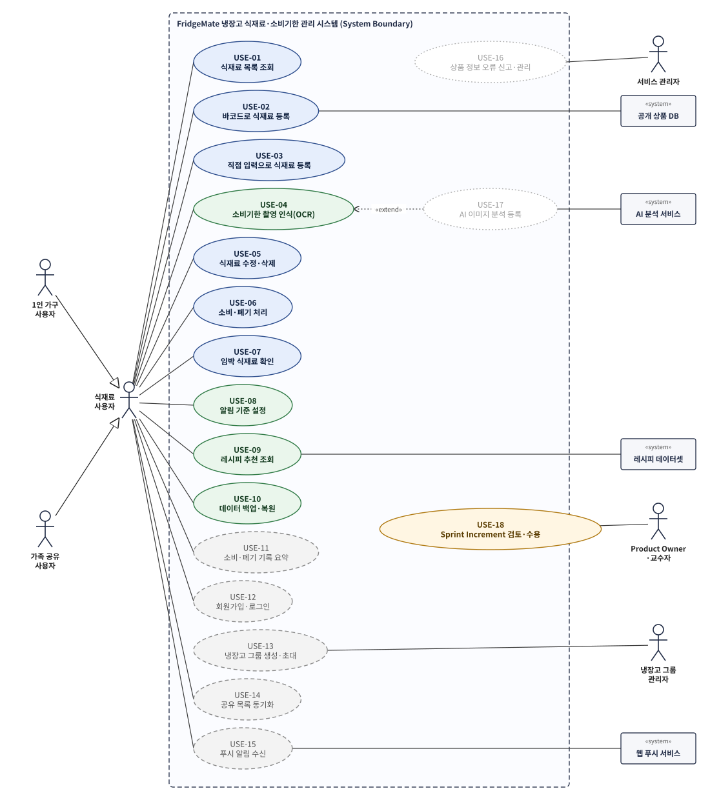

그림 1. FridgeMate 전체 Use Case Diagram

## 6. Use Case별 Diagram

4장의 Use Case별로 주 Actor(왼쪽)와 관련 Actor(오른쪽)의 관계를 나타낸다. 타원 위의 표기는 우선순위와 구현 Release이다.

**USE-01 식재료 목록 조회** — 주 Actor: 식재료 사용자 | 관련 Actor: -

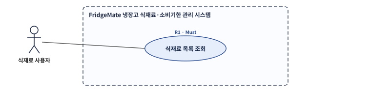

**USE-02 바코드로 식재료 등록** — 주 Actor: 식재료 사용자 | 관련 Actor: 공개 상품 DB, 스마트폰 카메라

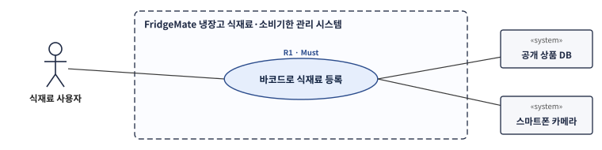

**USE-03 직접 입력으로 식재료 등록** — 주 Actor: 식재료 사용자 | 관련 Actor: -

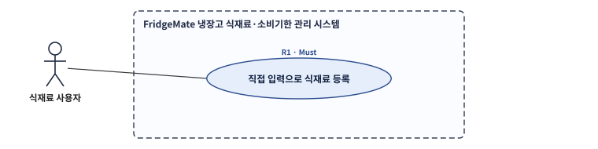

**USE-04 소비기한 촬영 인식(OCR)** — 주 Actor: 식재료 사용자 | 관련 Actor: 스마트폰 카메라

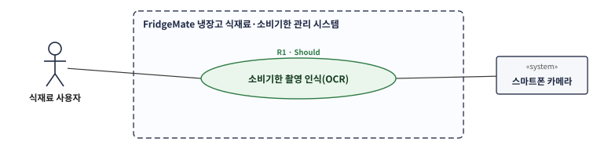

**USE-05 식재료 수정·삭제** — 주 Actor: 식재료 사용자 | 관련 Actor: -

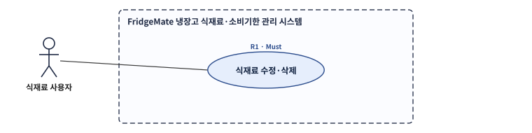

**USE-06 소비·폐기 처리** — 주 Actor: 식재료 사용자 | 관련 Actor: -

**USE-07 임박 식재료 확인** — 주 Actor: 식재료 사용자 | 관련 Actor: 단말 알림(OS)

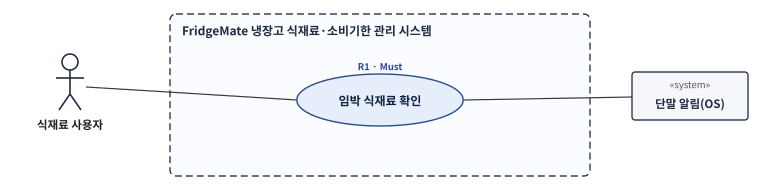

**USE-08 알림 기준 설정** — 주 Actor: 식재료 사용자 | 관련 Actor: -

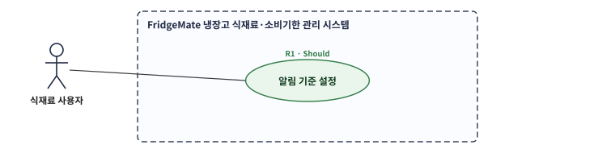

**USE-09 레시피 추천 조회** — 주 Actor: 식재료 사용자 | 관련 Actor: 레시피 데이터셋

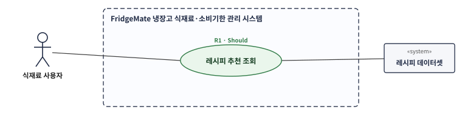

**USE-10 데이터 백업·복원** — 주 Actor: 식재료 사용자 | 관련 Actor: 단말 파일 저장소

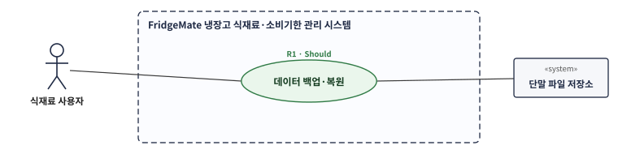

**USE-11 소비·폐기 기록 요약** — 주 Actor: 식재료 사용자 | 관련 Actor: -

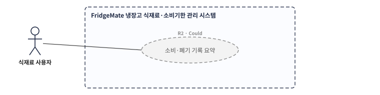

**USE-12 회원가입·로그인** — 주 Actor: 가족 공유 사용자 | 관련 Actor: -

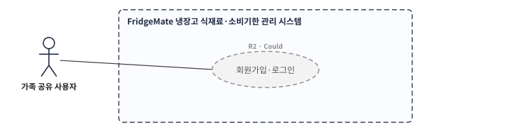

**USE-13 냉장고 그룹 생성·초대** — 주 Actor: 냉장고 그룹 관리자 | 관련 Actor: 가족 공유 사용자

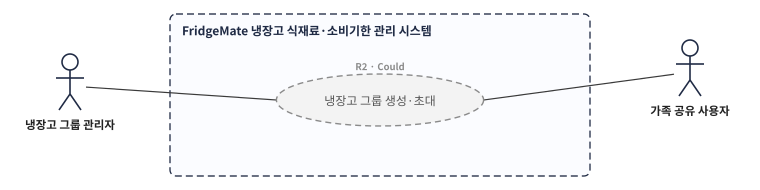

**USE-14 공유 목록 동기화** — 주 Actor: 가족 공유 사용자 | 관련 Actor: 동기화 서버

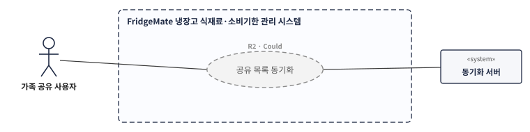

**USE-15 푸시 알림 수신** — 주 Actor: 식재료 사용자 | 관련 Actor: 웹 푸시 서비스

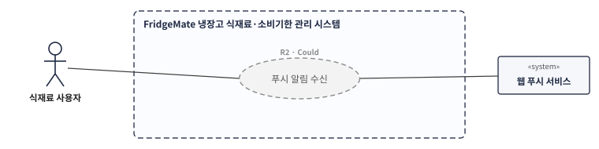

**USE-16 상품 정보 오류 신고·관리** — 주 Actor: 서비스 관리자 | 관련 Actor: 식재료 사용자

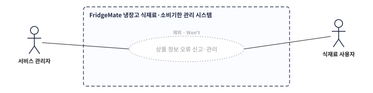

**USE-17 AI 이미지 분석 등록** — 주 Actor: 식재료 사용자 | 관련 Actor: AI 분석 서비스

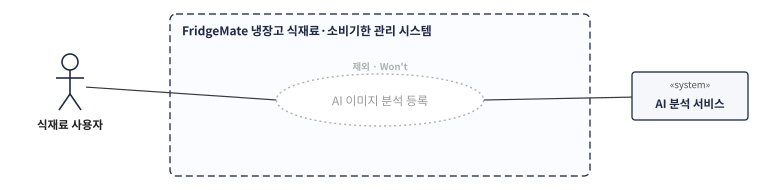

**USE-18 Sprint Increment 검토·수용** — 주 Actor: Product Owner·교수자 | 관련 Actor: 개발팀

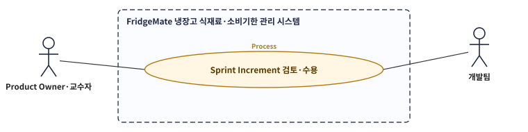

## 7. Use Case 시나리오

각 시나리오는 사전조건, 시작조건, 기본 흐름, 대체·예외 흐름, 성공기준과 관련 요구사항을 포함한다. 상세 Diagram에서 «include»는 기본 흐름에 항상 포함되는 하위 기능, «extend»는 조건이 충족될 때만 수행되는 대체·예외 흐름이다. 성공기준의 수치는 요구사항 명세서(FM-SRS-001)의 비기능 요구사항과 같다.

### SCN-01 바코드로 식재료 등록

| 항목 | 내용 |
|---|---|
| 시나리오 ID | SCN-01 |
| Use Case | USE-02 바코드로 식재료 등록 (포함: USE-01) |
| 목적 | 장 본 가공식품을 바코드 스캔으로 입력 부담 없이 등록 |
| 주 Actor | 식재료 사용자 |
| 관련 Actor | 스마트폰 카메라, 공개 상품 DB |
| 우선순위 / Release | Must / R1 |
| 사전조건 | 앱이 실행되어 있고 카메라 권한 요청이 가능한 상태 |
| 시작조건 | 사용자가 목록 화면에서 "바코드로 등록"을 누름 |
| 종료조건 | 식재료가 보관 위치별 목록에 D-day와 함께 표시됨 |

**기본 흐름**

1. 사용자가 "바코드로 등록"을 누른다.
2. 시스템이 후면 카메라 화면을 연다.
3. 사용자가 상품 바코드를 화면 안내선 안에 비춘다.
4. 시스템이 바코드(EAN-13·EAN-8·UPC-A)를 인식하고 진동 또는 효과음으로 알린다.
5. 시스템이 단말의 상품 정보 캐시를 먼저 확인하고, 없으면 공개 상품 DB에 조회한다.
6. 시스템이 상품명, 분류, 분류별 기본 보관 위치를 채운 등록 화면을 보여준다.
7. 사용자가 소비기한을 입력하고 수량·보관 위치를 확인한 뒤 저장한다.
8. 시스템이 D-day와 상태를 계산하여 목록에 표시한다.

**대체·예외 흐름**

- **E1 (4단계):** 바코드가 10초 동안 인식되지 않거나 카메라 권한이 거부되면 "번호로 입력" 화면을 보여준다. 사용자가 바코드 숫자를 입력하면 5단계로 이어간다.
- **E2 (5단계):** 공개 상품 DB에 정보가 없거나 5초 안에 응답이 없으면 상품명을 비워 둔 등록 화면을 보여주고 사용자가 직접 입력한다. 입력한 상품명은 해당 바코드와 함께 단말에 저장되어 다음 스캔에서 자동으로 채워진다.
- **E3 (5단계):** 네트워크가 연결되어 있지 않으면 "오프라인이라 상품 정보를 불러올 수 없어요" 안내 후 E2와 같이 직접 입력으로 전환한다.
- **A1 (7단계):** 사용자가 "소비기한 촬영"을 누르면 SCN-03으로 이동하고, 인식 결과를 확인한 뒤 7단계로 돌아온다.
- **A2 (8단계):** 같은 바코드의 미처리 식재료가 있으면 "새로 추가 / 수량 더하기" 중 선택하게 한다.

**성공기준**

- 상품 DB에 있는 상품은 바코드 스캔 시작부터 저장 완료까지 10초 이내에 끝난다. (NFR-PERF-001)
- 바코드가 화면에 들어온 뒤 인식까지 p95 3초 이내이다. (NFR-PERF-002)
- 상품 DB 조회가 실패해도 등록을 끝낼 수 있다. (NFR-REL-003)

**관련 요구사항:** FUN-007~012, FUN-016, DAT-001~003, DAT-006~007, INT-001~004, NFR-PERF-001~002, NFR-REL-001, NFR-REL-007

**SCN-01 상세 Use Case Diagram** — 주 Actor: 식재료 사용자 · 관련 Actor: 스마트폰 카메라, 공개 상품 DB

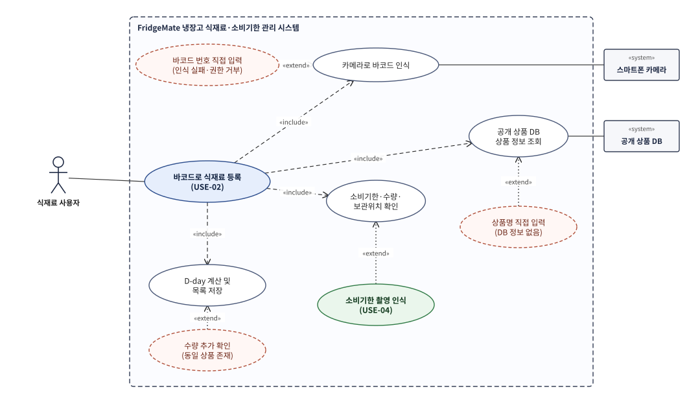

그림 2. SCN-01 바코드로 식재료 등록 상세 Use Case Diagram

### SCN-02 직접 입력으로 식재료 등록

| 항목 | 내용 |
|---|---|
| 시나리오 ID | SCN-02 |
| Use Case | USE-03 직접 입력으로 식재료 등록 |
| 목적 | 바코드가 없는 신선식품(채소·육류·반찬)을 적은 입력으로 등록 |
| 주 Actor | 식재료 사용자 |
| 관련 Actor | - |
| 우선순위 / Release | Must / R1 |
| 사전조건 | 앱이 실행된 상태 (네트워크 연결 불필요) |
| 시작조건 | 사용자가 "직접 입력"을 누름 |
| 종료조건 | 식재료가 목록에 표시됨 |

**기본 흐름**

1. 사용자가 "직접 입력"을 누른다.
2. 사용자가 품목명을 입력하면 시스템이 내장 품목 사전에서 일치하는 품목을 최대 5개 제안한다.
3. 사용자가 제안 품목을 선택한다.
4. 시스템이 품목 분류의 권장 보관기간으로 소비기한 기본값과 기본 보관 위치를 채운다.
5. 사용자가 수량·보관 위치·소비기한을 확인하고 저장한다.
6. 시스템이 D-day와 상태를 계산하여 목록에 표시한다.

**대체·예외 흐름**

- **A1 (3단계):** 제안에 없는 품목이면 사용자가 분류를 직접 고른다. 시스템은 저장 후 해당 품목을 "자주 쓰는 품목"에 추가한다.
- **A2 (4단계):** 사용자가 "소비기한 촬영"을 누르면 SCN-03으로 이동한다.
- **E1 (5단계):** 품목명·수량·보관 위치·소비기한 중 하나라도 비어 있거나 수량이 0 이하이면 저장하지 않고 해당 입력칸과 수정 방법을 표시한다.

**성공기준**

- 제안 품목을 선택하는 경우 3회 이하의 터치로 등록을 끝낸다. (NFR-USA-003)
- 네트워크가 끊긴 상태에서도 등록이 완료된다. (NFR-REL-003)

**관련 요구사항:** FUN-013~016, DAT-001~004, DAT-009, NFR-USA-003~005

**SCN-02 상세 Use Case Diagram** — 주 Actor: 식재료 사용자

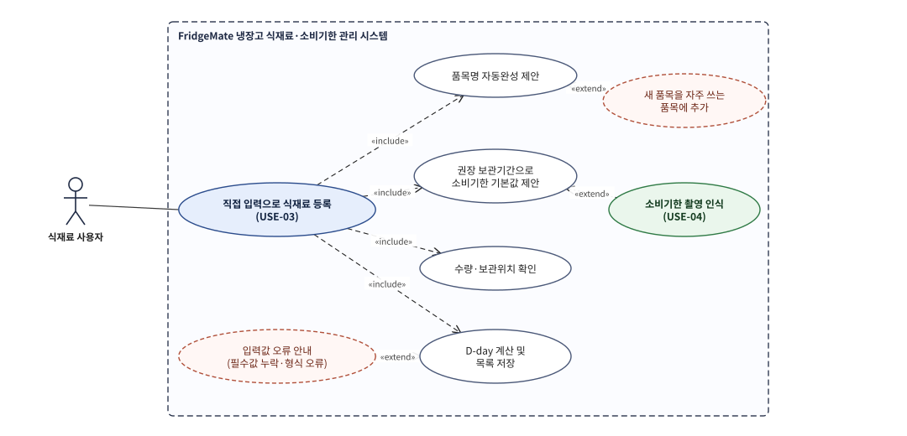

그림 3. SCN-02 직접 입력으로 식재료 등록 상세 Use Case Diagram

### SCN-03 소비기한 촬영 인식(OCR)

| 항목 | 내용 |
|---|---|
| 시나리오 ID | SCN-03 |
| Use Case | USE-04 소비기한 촬영 인식(OCR) |
| 목적 | 바코드로 알 수 없는 소비기한을 사진으로 읽어 입력 부담을 줄임 (이석환 제안 기능) |
| 주 Actor | 식재료 사용자 |
| 관련 Actor | 스마트폰 카메라 |
| 우선순위 / Release | Should / R1 (무료 OSS OCR까지만 구현, 유료 AI 분석은 Won't) |
| 사전조건 | SCN-01 또는 SCN-02의 등록 화면이 열려 있음 |
| 시작조건 | 사용자가 "소비기한 촬영"을 누름 |
| 종료조건 | 사용자가 확인한 소비기한이 등록 화면에 적용됨 |

**기본 흐름**

1. 시스템이 카메라 화면과 "소비기한 부분만 크게 찍어 주세요" 안내를 보여준다.
2. 사용자가 소비기한 인쇄 부분을 촬영한다.
3. 시스템이 브라우저 안에서 OCR 엔진으로 문자를 인식한다. 사진은 외부로 전송하지 않는다.
4. 시스템이 인식 문자열에서 날짜 후보를 추출하고 "제조" 표기가 붙은 날짜는 제외한다.
5. 시스템이 소비기한 후보와 인식된 원문을 함께 보여준다.
6. 사용자가 날짜를 확인·수정하고 "적용"을 누른다.
7. 시스템이 등록 화면의 소비기한 칸에 값을 채운다.

**대체·예외 흐름**

- **A1 (2단계):** 사용자가 "사진 불러오기"로 단말에 저장된 사진을 선택할 수 있다.
- **E1 (3단계):** 문자를 인식하지 못하면 "글자를 읽지 못했어요. 직접 입력해 주세요"를 표시하고 수동 입력으로 전환한다.
- **E2 (4단계):** 날짜 후보가 없거나 2개 이상이면 소비기한 칸을 빈칸으로 두고 후보 목록에서 사용자가 고르게 한다. 시스템은 날짜를 임의로 확정하지 않는다.

**성공기준**

- 사용자가 확인하지 않은 OCR 결과가 저장되는 경우가 0건이다. (FUN-021)
- 시험 이미지 30장에서 소비기한 정답 추출률 70% 이상, 이미지 1장 처리 p95 8초 이내이다. (NFR-REL-006, NFR-PERF-005)

**관련 요구사항:** FUN-017~022, INT-008, NFR-PERF-005, NFR-REL-006, NFR-SEC-002

**SCN-03 상세 Use Case Diagram** — 주 Actor: 식재료 사용자 · 관련 Actor: 스마트폰 카메라

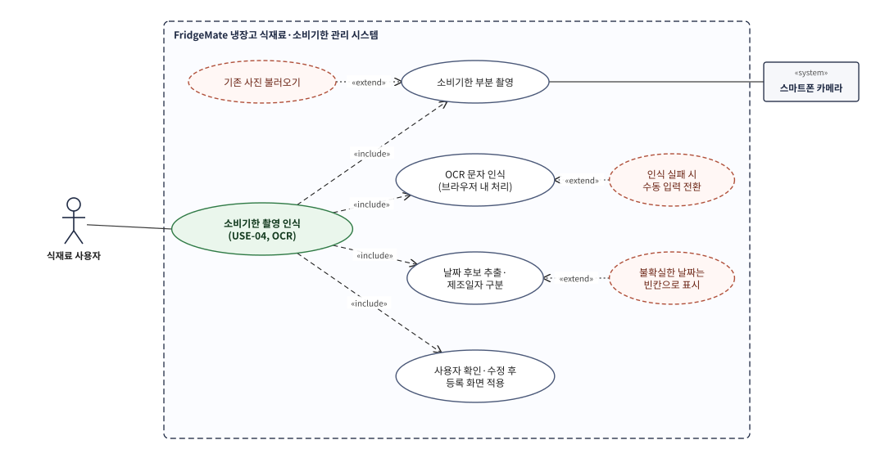

그림 4. SCN-03 소비기한 촬영 인식 상세 Use Case Diagram

### SCN-04 임박 식재료 확인 및 소비·폐기 처리

| 항목 | 내용 |
|---|---|
| 시나리오 ID | SCN-04 |
| Use Case | USE-07 임박 식재료 확인, USE-06 소비·폐기 처리 (관련: USE-05, USE-08) |
| 목적 | 소비기한이 지나기 전에 사용자가 인지하고 소비하도록 유도 |
| 주 Actor | 식재료 사용자 |
| 관련 Actor | 단말 알림(OS) |
| 우선순위 / Release | Must / R1 (단말 알림 표시는 Should) |
| 사전조건 | 등록된 식재료가 1개 이상 있음 |
| 시작조건 | 사용자가 앱을 실행하거나, 실행 중 단말 날짜가 바뀜 |
| 종료조건 | 사용자가 처리한 식재료가 목록에서 제외되고 이력에 남음 |

**기본 흐름**

1. 시스템이 모든 식재료의 D-day를 계산하고 상태(보관·여유·임박·오늘까지·기한 경과)를 판정한다.
2. 시스템이 목록 상단 요약 영역에 "임박 3개 · 오늘까지 1개" 형태로 개수와 품목명을 표시한다.
3. 사용자가 요약을 눌러 임박 품목 목록을 연다.
4. 사용자가 먹은 품목에 "소비", 버린 품목에 "폐기"를 누른다.
5. 시스템이 처리 유형·수량·처리 일시를 이력에 저장하고 목록에서 제외한다.

**대체·예외 흐름**

- **A1 (2단계):** 단말 알림 권한이 허용되어 있고 오늘 알림을 아직 보내지 않았으면, 단말 알림으로 "우유 외 2개가 곧 소비기한이에요"를 표시한다. 권한이 없으면 앱 내 요약만 표시한다.
- **A2 (2단계):** 기한 경과 품목은 "확인 필요"로 따로 표시하여 소비·폐기 처리를 유도한다.
- **A3 (4단계):** 일부 수량만 먹었으면 처리 수량을 입력하고, 시스템은 남은 수량을 갱신한 뒤 목록에 유지한다.
- **A4 (4단계):** 여러 품목을 선택하여 한 번에 처리할 수 있다.
- **A5:** 사용자는 설정에서 임박 기준일(1~7일, 기본 3일)과 단말 알림 사용 여부를 바꿀 수 있다. (USE-08)

**성공기준**

- 시험 데이터 30건(경계값 D-7, D-4, D-3, D-1, D-0, D+1 포함)의 상태 판정 오류가 0건이다. (NFR-REL-002)
- 상태는 색상과 문자 라벨로 함께 구분된다. (FUN-004, NFR-USA-001)
- 처리한 식재료는 다시 임박 요약에 포함되지 않는다.

**관련 요구사항:** FUN-001~004, FUN-025~036, DAT-002, DAT-005, DAT-008, INT-006, NFR-REL-002

**SCN-04 상세 Use Case Diagram** — 주 Actor: 식재료 사용자 · 관련 Actor: 단말 알림(OS)

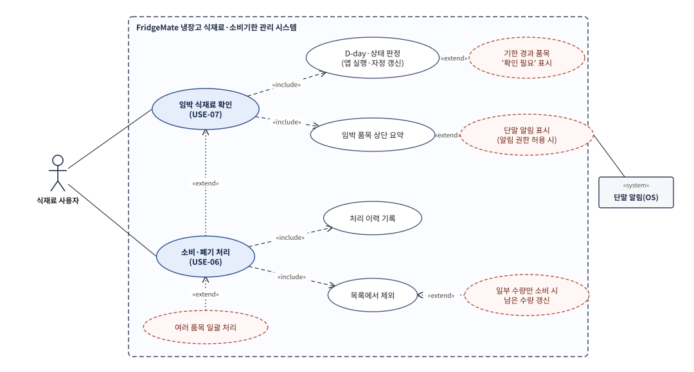

그림 5. SCN-04 임박 식재료 확인 및 소비·폐기 처리 상세 Use Case Diagram

### SCN-05 남은 재료로 레시피 추천

| 항목 | 내용 |
|---|---|
| 시나리오 ID | SCN-05 |
| Use Case | USE-09 레시피 추천 조회 |
| 목적 | 임박 재료를 활용할 메뉴 결정을 지원 |
| 주 Actor | 식재료 사용자 |
| 관련 Actor | 레시피 데이터셋 (앱 내장) |
| 우선순위 / Release | Should / R1 |
| 사전조건 | 등록된 식재료가 1개 이상 있음 |
| 시작조건 | 사용자가 "오늘 뭐 먹지?"를 누름 |
| 종료조건 | 사용자가 추천 레시피를 확인함 |

**기본 흐름**

1. 시스템이 보유 식재료 목록을 불러온다.
2. 시스템이 내장 레시피 데이터셋의 재료와 보유 식재료를 품목명 기준으로 비교한다.
3. 시스템이 보유 재료를 1개 이상 쓰는 레시피를 고르고, 임박·오늘까지 재료를 많이 쓰는 순으로 정렬한다.
4. 시스템이 레시피마다 "있는 재료 / 부족한 재료"를 구분해 보여준다.
5. 사용자가 레시피를 눌러 조리 방법과 출처를 확인한다.

**대체·예외 흐름**

- **E1 (3단계):** 조건에 맞는 레시피가 없으면 "지금 재료로 추천할 레시피가 없어요"를 표시한다.

**성공기준**

- 레시피 50개, 식재료 30개 조건에서 추천 결과가 p95 2초 이내에 표시된다. (NFR-PERF-006)
- 추천 레시피 1위는 임박 재료 사용 수가 가장 많은 레시피이다. (FUN-038)

**관련 요구사항:** FUN-037~040, DAT-009, NFR-PERF-006, NFR-OSS-005

**SCN-05 상세 Use Case Diagram** — 주 Actor: 식재료 사용자 · 관련 Actor: 레시피 데이터셋

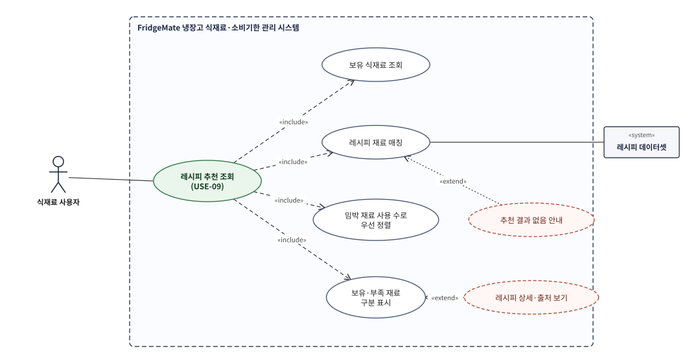

그림 6. SCN-05 레시피 추천 상세 Use Case Diagram

### SCN-06 데이터 백업·복원 (기기 변경)

| 항목 | 내용 |
|---|---|
| 시나리오 ID | SCN-06 |
| Use Case | USE-10 데이터 백업·복원 |
| 목적 | R1은 서버가 없으므로, 기기 변경·브라우저 데이터 삭제에 대비해 사용자가 데이터를 파일로 보관 |
| 주 Actor | 식재료 사용자 |
| 관련 Actor | 단말 파일 저장소 |
| 우선순위 / Release | Should / R1 |
| 사전조건 | (내보내기) 저장된 데이터가 있음 / (가져오기) 백업 파일이 있음 |
| 시작조건 | 사용자가 설정에서 "백업 내보내기" 또는 "백업 가져오기"를 누름 |
| 종료조건 | 백업 파일이 저장되거나, 데이터가 복원되어 목록에 표시됨 |

**기본 흐름 (내보내기)**

1. 시스템이 식재료·처리 이력·설정 전체를 하나의 JSON으로 변환한다.
2. 시스템이 `fridgemate-backup-YYYYMMDD.json` 파일로 저장한다.

**기본 흐름 (가져오기)**

1. 사용자가 백업 파일을 선택한다.
2. 시스템이 파일 형식과 스키마 버전을 검증한다.
3. 사용자가 "합치기" 또는 "덮어쓰기"를 고른다.
4. 시스템이 데이터를 반영하고 복원된 항목 수를 알려준다.

**대체·예외 흐름**

- **E1 (가져오기 2단계):** 형식이 맞지 않으면 "FridgeMate 백업 파일이 아니에요"를 표시하고 기존 데이터를 변경하지 않는다.
- **A1 (가져오기 3단계):** "덮어쓰기"를 고르면 "현재 데이터 N건이 지워집니다" 확인을 한 번 더 받는다.

**성공기준**

- 식재료 100건과 이력 50건을 내보낸 뒤 새 브라우저에서 가져오면 항목 수와 필드 값이 100% 일치한다. (NFR-REL-005)

**관련 요구사항:** FUN-041~043, DAT-010, INT-007, NFR-REL-005

**SCN-06 상세 Use Case Diagram** — 주 Actor: 식재료 사용자 · 관련 Actor: 단말 파일 저장소

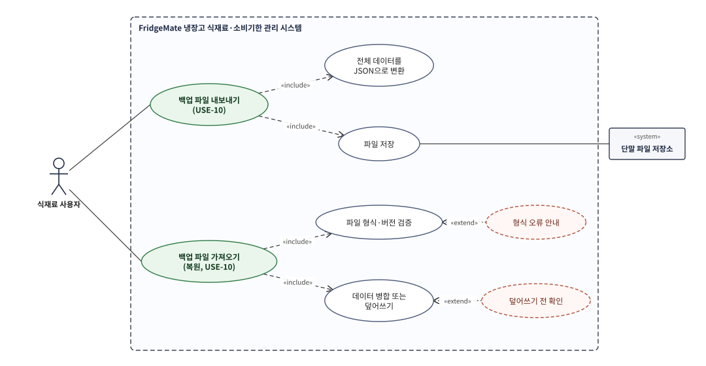

그림 7. SCN-06 데이터 백업·복원 상세 Use Case Diagram

### SCN-07 가족과 냉장고 공유 (R2 · 후속 Release)

| 항목 | 내용 |
|---|---|
| 시나리오 ID | SCN-07 |
| Use Case | USE-12 회원가입·로그인, USE-13 냉장고 그룹 생성·초대, USE-14 공유 목록 동기화 |
| 목적 | 가족 구성원이 같은 냉장고 목록을 함께 보고 중복 구매를 막음 |
| 주 Actor | 냉장고 그룹 관리자, 가족 공유 사용자 |
| 관련 Actor | 동기화 서버 |
| 우선순위 / Release | Could / **R2 — 이번 학기에는 요구사항과 시나리오만 정의하고 구현하지 않음** |
| 사전조건 | R2 서버(인증·동기화)가 구축되어 있음 |
| 시작조건 | 그룹 관리자가 "가족 초대"를 누름 |
| 종료조건 | 초대받은 구성원이 그룹 목록을 보고 변경 사항이 서로 반영됨 |

**기본 흐름**

1. 그룹 관리자가 회원가입·로그인 후 냉장고 그룹을 만든다.
2. 관리자가 "가족 초대"를 눌러 초대 링크를 만들고 메신저로 전달한다.
3. 가족 구성원이 링크로 가입·로그인하고 초대를 수락한다.
4. 구성원 화면에 그룹 식재료 목록이 표시된다.
5. 누군가 식재료를 등록·수정·처리하면 10초 이내에 다른 구성원 화면에 반영되고, 등록자·수정자가 기록된다.

**대체·예외 흐름**

- **E1 (3단계):** 초대 링크는 생성 7일 후 만료되며, 만료 링크로 접속하면 "초대가 만료됐어요"를 표시한다.
- **E2 (5단계):** 두 사람이 같은 품목을 동시에 수정하면 나중 수정이 반영되고 변경 내역에는 두 수정이 모두 남는다.

**R2로 분리한 이유:** 인증·동기화 서버, 개인정보(이메일) 처리, 서버 운영비와 보안 점검이 필요하여 이번 학기 일정(팀원 3명)에 R1 핵심 기능과 함께 구현하면 R1 완성도가 떨어질 위험이 크다. R1의 백업·복원(SCN-06)으로 기기 간 데이터 이동은 우선 지원한다.

**관련 요구사항:** FUN-047~052, DAT-012, INT-010~012, NFR-SEC-005

**SCN-07 상세 Use Case Diagram (R2)** — 주 Actor: 냉장고 그룹 관리자, 가족 공유 사용자 · 관련 Actor: 동기화 서버

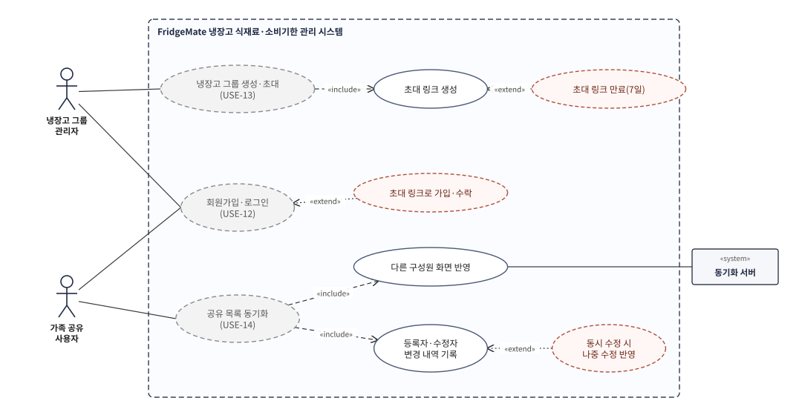

그림 8. SCN-07 가족과 냉장고 공유(R2) 상세 Use Case Diagram

## 8. Use Case-요구사항 추적표

| Use Case | 시나리오 | 기능 요구사항 | 비기능·데이터·인터페이스 요구사항 | 운용개념서 시나리오 |
|---|---|---|---|---|
| USE-01 목록 조회 | SCN-01~04 | FUN-001~006, FUN-044 | NFR-PERF-003, NFR-USA-001~002, DAT-001~003 | OS-01, OS-02 |
| USE-02 바코드 등록 | SCN-01 | FUN-007~012, FUN-045 | NFR-PERF-001~002, NFR-REL-001, 007, INT-001~004 | OS-01, OS-04 |
| USE-03 직접 입력 | SCN-02 | FUN-013~016 | NFR-USA-003~004, DAT-009 | OS-01, OS-04 |
| USE-04 소비기한 OCR | SCN-03 | FUN-017~022 | NFR-PERF-005, NFR-REL-006, INT-008 | OS-01 |
| USE-05 수정·삭제 | SCN-04 | FUN-025~026 | DAT-001 | OS-02 |
| USE-06 소비·폐기 | SCN-04 | FUN-027~030 | DAT-005 | OS-02 |
| USE-07 임박 확인 | SCN-04 | FUN-031~034 | NFR-REL-002, INT-006 | OS-02 |
| USE-08 알림 기준 | SCN-04 | FUN-035~036 | DAT-008 | OS-02 |
| USE-09 레시피 추천 | SCN-05 | FUN-037~040 | NFR-PERF-006, DAT-009 | OS-03 |
| USE-10 백업·복원 | SCN-06 | FUN-041~043 | NFR-REL-005, DAT-010, INT-007 | OS-05 |
| USE-11~15 (R2) | SCN-07 | FUN-046~052 | DAT-012, INT-010~012, NFR-SEC-005 | OS-06 |
| USE-16~17 (Won't) | - | FUN-024, FUN-053~054 | - | - |

## 9. 검토 체크리스트

- [ ] 모든 주 사용자 User Class(UC-01~03)가 Actor로 표현되어 있다.
- [ ] 외부 시스템(공개 상품 DB, 카메라, 단말 OS, 레시피 데이터)이 Actor로 식별되어 있다.
- [ ] 모든 Use Case에 우선순위와 구현 Release가 표기되어 있다.
- [ ] R1 Use Case(10개)마다 1개 이상의 시나리오 또는 추적 요구사항이 있다.
- [ ] 각 시나리오에 사전조건, 시작조건, 기본 흐름, 대체·예외 흐름, 성공기준이 있다.
- [ ] «include»는 필수 하위 기능, «extend»는 조건부 흐름으로 일관되게 사용했다.
- [ ] 성공기준 수치가 요구사항 명세서의 비기능 요구사항과 일치한다.
- [ ] R2·Won't Use Case의 분리 사유가 기록되어 있다.

## 10. 검토 및 승인

| 구분 | 성명 | 검토결과 | 일자 | 의견 |
|---|---|---|---|---|
| 작성 | 냉장고팀 | 작성 완료 | 2026-10-15 | |
| Reviewer | 이지선 | | | |
| 개발자 관점 검토 | 이석환 | | | |
| Scrum Master·Product Owner | 이정남 | | | |
| 교수자 | 최태봉 교수님 | | | |

## 부록 A. 용어

| 용어 | 설명 |
|---|---|
| Actor | 시스템과 상호작용하는 사용자 또는 외부 시스템 |
| Use Case | Actor가 시스템을 통해 목표를 달성하는 하나의 상호작용 단위 |
| «include» | 기본 Use Case가 항상 포함하여 수행하는 하위 Use Case |
| «extend» | 특정 조건에서만 기본 Use Case에 덧붙는 Use Case |
| Generalization | Actor 사이의 상속 관계 (하위 Actor는 상위 Actor의 Use Case를 모두 사용) |
| D-day | 오늘 날짜에서 소비기한까지 남은 일수 (당일 0, 지나면 음수) |
| R1 / R2 | 구현 Release. R1은 이번 학기 MVP, R2는 후속 Release |
| PWA | Progressive Web App. 브라우저에서 실행되며 홈 화면 설치와 오프라인 동작이 가능한 웹 앱 |

## 부록 B. GitHub 작업정보

| 항목 | 내용 |
|---|---|
| Branch | `docs/3-usecase` |
| Commit 메시지 예시 | `docs: add use case scenarios and diagrams` |
| Pull Request 제목 예시 | `[Issue #3] Use Case 시나리오 및 Use Case Diagram 작성` |
| PR 본문 연결문구 | `Relates to #9` |
| 이미지 원본 | `docs/usecase/images/*.svg` (GitHub에서 바로 표시됨) |
